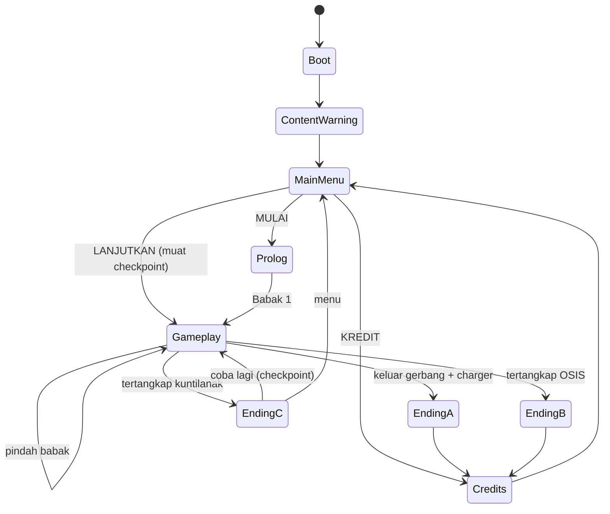

# ARCHITECT.md: Arsitektur Teknis Charger Diana (PRD V2 + V3)

Dokumen ini menjelaskan **bagaimana** game dibangun. Cakupan dan prioritas ada di `PRD_V2.md` (game) dan `PRD_V3.md` (produksi aset 3D). Aturan kerja agent ada di `AGENTS.md`.

> **Catatan status:** semua milestone Must PRD V2 sudah selesai. Bagian 1-19 mendefinisikan arsitektur game (V2). **Bagian 20 menambahkan pipeline aset 3D untuk PRD V3** (Blender ke Godot, karakter, animasi, tangan/HP first-person). V3 **tidak menambah autoload**. Bila kode yang ada berbeda dari dokumen ini, catat selisihnya di audit A2 (V3) dan rapikan bertahap lewat milestone terkait, bukan sekaligus.

## 1. Prinsip Arsitektur

1. **Alur utuh dulu**: boot, menu, prolog, tiga babak, ending, kredit harus tersambung end-to-end sebelum dipoles.
2. **Satu pintu per tanggung jawab**: pindah scene lewat `SceneManager`, pengaturan lewat `SettingsManager`, save lewat `SaveSystem`, audio lewat `AudioManager`.
3. **Data, bukan hardcode**: tuning, profil OSIS, puzzle, catatan, baris VO berupa `Resource`.
4. **Longgar antar sistem**: komunikasi lewat signal / `EventBus`.
5. **Logika murni terpisah** dari Godot (`scripts/core/`) supaya bisa diuji tanpa membuka editor. Build C# di Celeron lambat.
6. **Performa adalah fitur**: semua keputusan dicek terhadap target Celeron/8 GB/iGPU.

## 2. Teknologi

| Item | Pilihan |
|---|---|
| Engine | Godot 4.x .NET, C# |
| Renderer | Compatibility (OpenGL), tanpa fitur khusus Forward+/Mobile |
| Platform | Windows, mouse + keyboard |
| Navmesh | `NavigationRegion3D` per zona |
| Fisika | Jolt atau bawaan, pilih yang lebih ringan di Celeron (ukur di A1) |
| Format save | JSON (`System.Text.Json`) di `user://save.json` |
| Format settings | `ConfigFile` di `user://settings.cfg` |
| Log | `user://logs/` lewat `GameLog` |
| Modeling aset (V3) | Blender (versi dikunci di A1 PRD V3), ekspor glTF 2.0 `.glb` |
| Tekstur aset (V3) | Krita (atlas piksel), sumber CC0 hanya untuk tekstur/material |
| Animasi karakter (V3) | Universal Animation Library (CC0) di-retarget lewat BoneMap |

## 3. Struktur Folder

```
res://
├─ AGENTS.md / ARCHITECT.md / DESIGN.md / PRD_V2.md
├─ design_reference/            # screenshot + notes Stitch (bukan kode game)
├─ assets/
│  ├─ ASSETS.md                 # sumber + lisensi tiap aset (untuk kredit)
│  ├─ fonts/  shaders/
│  ├─ textures/ {atlas, decals}/        # atlas final (PNG kecil, nearest)
│  ├─ models/ {arch, furniture, props, characters, outdoor, prolog}/   # .glb hasil download CC0 (tanpa Blender)
│  ├─ materials/                        # mat_<kelompok>_atlas.tres (material PS1)
│  ├─ animations/                       # pustaka animasi CC0 + BoneMap/retarget
│  └─ audio/ {ambience, sfx, vo, stingers}
├─ data/
│  ├─ osis/        # OsisProfile .tres: cecillia, adam, ferdi
│  ├─ puzzles/     # PuzzleDef .tres
│  ├─ notes/       # NoteDef .tres
│  ├─ chapters/    # ChapterDef .tres (babak 1-3)
│  ├─ vo/          # VoLine .tres / tabel baris VO
│  ├─ cutscenes/   # CutsceneDef .tres (prolog, ending A/B/C)
│  ├─ presets/     # GraphicsPreset .tres: rendah, sedang, tinggi
│  └─ strings/     # teks UI dan copywriting (Indonesia)
├─ scenes/
│  ├─ boot/ ContentWarning.tscn, Boot.tscn
│  ├─ menu/ MainMenu.tscn
│  ├─ prolog/ PrologRoom.tscn, PrologRoad.tscn
│  ├─ levels/ Chapter1.tscn, Chapter2.tscn, Chapter3.tscn, zones/
│  ├─ endings/ EndingA.tscn, EndingB.tscn, GameOver.tscn
│  ├─ ui/ Hud, PhoneUi, NoteReader, PauseMenu, Settings, Loading, Credits, Intro
│  │  └─ components/  MenuButton, BatteryIndicator, StaminaBar, InteractPrompt,
│  │                  SubtitleBox, NoteSheet, DialogueBox, SettingRow, ScreenFader
│  ├─ props/ {arch, furniture, items, outdoor}/   # scene turunan per aset (.tscn)
│  ├─ debug/ PerfOverlay.tscn         # F3, hanya build debug
│  └─ actors/ Player (+ ViewModel tangan/HP), Osis, Kuntilanak
├─ scripts/
│  ├─ core/        # logika murni, TANPA using Godot
│  ├─ autoload/    # singleton (lihat bagian 4)
│  ├─ player/  ai/  puzzle/  world/  audio/  cutscene/  ui/
│  └─ data/        # definisi Resource
├─ ui_theme.tres
├─ tools/ {blender, godot}  # validate_and_export.py, EditorScenePostImport (C#)
└─ tests/          # uji logika murni

(art/ = sumber .blend dan tekstur kerja, ada di repo terpisah `charger-diana-art`, bukan di proyek Godot ini)
```

Aturan: scene dan script bertetangga logis (satu fitur, satu folder). `scripts/core/` **tidak boleh** memakai namespace `Godot`.

## 4. Autoload (daftar tertutup)

Menambah autoload baru = ubah dokumen ini lebih dulu.

| Autoload | Tanggung jawab | Milestone |
|---|---|---|
| `EventBus` | Kumpulan signal global (lihat bagian 12) | A2 |
| `GameLog` | Tulis log ke file, level Info/Warn/Error | H2 (dasar di A2) |
| `SettingsManager` | Muat/simpan `settings.cfg`, terapkan ke engine, emit `SettingChanged` | C3 |
| `SaveSystem` | Checkpoint auto-save, muat, validasi versi, satu slot | C4 |
| `SceneManager` | Mesin status alur game, transisi dengan `ScreenFader`, loading | C1 |
| `AudioManager` | Bus, ducking, ambience zona, VO + sinkron subtitle, stinger | G1 |
| `GameState` | Status sesi: babak aktif, item, puzzle selesai, catatan terkumpul, flag | A2 |
| `InputRemapper` | Terapkan dan simpan rebind, deteksi konflik | C5 |

`GraphicsPresets` dan `CutsceneController` bukan autoload. `GraphicsPresets` adalah service statis yang dipanggil `SettingsManager`. `CutsceneController` adalah node yang di-instance oleh scene yang membutuhkannya.

## 5. Alur Game (`SceneManager`)



Kontrak `SceneManager`:

```csharp
public enum GameFlow { Boot, ContentWarning, MainMenu, Prolog, Gameplay, EndingA, EndingB, EndingC, Credits }

// API publik (ringkas)
void GoTo(GameFlow target, FlowArgs args = default);   // fade out, loading bila perlu, ganti scene, fade in
void StartNewGame();           // timpa save, mulai Prolog
void ContinueGame();           // muat checkpoint terakhir dari SaveSystem
void RetryFromCheckpoint();
event Action<GameFlow> FlowChanged;
```

- Semua transisi melewati `ScreenFader`. Tidak ada `ChangeSceneToFile` di luar `SceneManager`.
- Pemuatan aset berat (scene level) memakai `ResourceLoader.LoadThreadedRequest`. Loading screen menampilkan teks atmosfer, bukan tip.
- Boot memuat aset menu di balik `ContentWarning` supaya menu langsung responsif.
- Target: menu ke gameplay < 15 detik di Celeron.

## 6. Pengaturan (`SettingsManager`)

Disimpan di `user://settings.cfg`. Setiap perubahan **langsung diterapkan** dan disimpan.

| Kategori | Kunci | Penerapan |
|---|---|---|
| Audio | `volume_master`, `volume_sfx`, `volume_ambience`, `volume_vo` | `AudioServer.SetBusVolumeDb` |
| Subtitle | `subtitle_on`, `subtitle_size` | Dibaca `SubtitleBox` |
| Tampilan | `brightness`, `fullscreen`, `resolution` | `WorldEnvironment` adjustment / `DisplayServer` |
| Grafis | `graphics_preset` (Rendah/Sedang/Tinggi) | `GraphicsPresets.Apply` |
| Efek | `retro_effects`, `reduce_flicker` | Toggle overlay shader, `reduce_flicker` dibaca semua sumber kedip |
| Kontrol | `mouse_sensitivity`, `bindings` | `InputRemapper` |

- `SettingChanged(string key)` dipancarkan lewat `EventBus`. Sistem yang peduli subscribe, bukan polling.
- `reduce_flicker` harus dihormati oleh **semua** efek lampu berkedip: lampu rusak, telegraph kuntilanak, event terskrip, menu. Sediakan helper `FlickerPolicy.Scale(float intensity)` di `scripts/core/`.
- Nilai tidak valid atau file rusak: kembali ke default, tulis warning ke log, jangan crash.

## 7. Preset Grafis (`GraphicsPresets`)

Preset adalah `Resource` (`GraphicsPreset`) sehingga bisa dituning di H1 tanpa mengubah kode. **Angka di bawah hanya titik awal untuk di-tuning di Celeron.**

| Parameter | Rendah | Sedang | Tinggi |
|---|---|---|---|
| `Scaling3D` (skala render) | 0.60 | 0.75 | 1.0 |
| Bayangan senter | Mati | Hidup, resolusi kecil | Hidup |
| Shader PS1 (vertex snapping, dsb.) | Mati | Hidup | Hidup |
| Maks lampu aktif per zona | rendah | menengah | penuh |
| Overlay efek (grain/dither/vignette) | Mati | Ringan | Penuh |
| Jarak fog / culling | Pendek | Sedang | Sedang |

- Preset **Rendah** adalah patokan lulus FPS: 30 stabil di Celeron (45+ ideal).
- Preset awal default = Rendah di perangkat yang terdeteksi lemah, bila tidak, Sedang. Pemain tetap bisa mengubahnya.
- Bayangan real-time: hanya senter, hanya preset Sedang ke atas (sesuai PRD 4.9).

## 8. Save System

Satu slot, auto-save di checkpoint. `LANJUTKAN` memuat checkpoint terakhir.

```csharp
public sealed record SaveData
{
    public int Version { get; init; }          // naik tiap skema berubah
    public string SavedAtUtc { get; init; }
    public int Chapter { get; init; }          // 1..3
    public string CheckpointId { get; init; }  // id marker di level
    public float BatteryPercent { get; init; }
    public string[] Inventory { get; init; }
    public string[] SolvedPuzzles { get; init; }
    public string[] CollectedNotes { get; init; }
    public string[] Flags { get; init; }       // event terskrip yang sudah terjadi
    public int Deaths { get; init; }
    public double PlaySeconds { get; init; }
}
```

- **Tulis atomik:** tulis ke `save.json.tmp`, lalu ganti nama ke `save.json`. Simpan cadangan `save.json.bak`.
- **Validasi:** `Version` lebih baru dari yang dikenal, JSON rusak, atau `CheckpointId` tidak ada: tolak dengan aman, tombol LANJUTKAN nonaktif, tulis log. Jangan crash.
- **Migrasi:** tiap kenaikan `Version` punya fungsi migrasi di `scripts/core/`.
- **Checkpoint:** marker di level (`CheckpointMarker`), id unik, dipicu masuk area atau puzzle selesai. Checkpoint harus rapat supaya tidak soft-lock.
- **Uji wajib (E3/E7):** dari setiap checkpoint, game bisa diselesaikan sampai ending. Tidak boleh ada state yang membuat pemain macet.
- `MULAI` baru saat save ada: konfirmasi dulu, lalu timpa.

## 9. Sistem Gameplay

### 9.1 Pemain
`Player` (CharacterBody3D, first-person): gerak, lari (stamina), jongkok (`Ctrl`), interaksi (`E`), senter, buka HP. Semua tombol lewat InputMap supaya bisa di-rebind.

### 9.2 Senter & Baterai
Logika drain/charge di `scripts/core/BatteryModel.cs` (murni). Node `Flashlight` hanya membaca model dan mengatur cahaya. Baterai juga tampil di `BatteryIndicator` (normal biru, rendah kuning).

### 9.3 Noise System
Aksi menghasilkan `NoiseEvent(position, loudness, source)` lewat `EventBus`. OSIS dan Kuntilanak mendengar sesuai radius dan lantai. Radius adalah tuning di Resource.

### 9.4 Hide & Tahan Napas
Interactable `HidingSpot` (loker, kolong). Saat bersembunyi, deteksi ditentukan fungsi murni di `core/` (jarak, arah, status tahan napas), sehingga mudah diuji.

### 9.5 AI OSIS (Cecillia, Adam, Ferdi)
- Satu class `OsisAgent` + `OsisProfile` (Resource: nama, sifat, kecepatan, kewaspadaan, `VoiceStyle`, rute per babak). **Sifat final ditetapkan di E5**, jadi jangan hardcode.
- Status: `Patrol → Suspicious → Investigate → Chase → Catch`, plus `Panic` (lari dari kuntilanak, nada serius).
- Rute per babak dari `ChapterDef`, bukan di dalam script AI.
- HT chatter dan seruan lewat `AudioManager.PlayVo` dengan filter radio. Karena ketiganya diisi satu orang, `VoiceStyle` menyimpan parameter pembeda (pitch, tempo, preset filter) dan nama bus/efek.
- Tertangkap OSIS memicu **Ending B** lewat `SceneManager`.

### 9.6 Kuntilanak
- Status: `Dormant → Telegraph → Appear → Hunt → Catch`.
- **Telegraph wajib dan konsisten** sebelum ancaman nyata: tawa terbalik, bau melati (cue audio/visual), lampu berkedip (lewat `FlickerPolicy`). Aturan harus adil dan bisa dipelajari.
- Encounter terskrip per babak (`ScriptedEncounter` di `ChapterDef`), makin intens. Babak 1 hanya terdengar, babak 2 penampakan pertama, babak 3 Hunting.
- Variasi tawa dan bisikan 5-8 klip, dipilih acak tanpa pengulangan berurutan.
- Tertangkap kuntilanak memicu **Ending C** (murni horror).

### 9.7 Puzzle
`PuzzleDef` (Resource) + `PuzzleController` per puzzle. P1 masuk (kunci di bawah pot dekat pos satpam, petunjuknya ditanam di chat prolog), P2 listrik, P3 kunci kelas, P4 charger, P5 jalan keluar, ditambah 2-3 puzzle kecil (Should). Status puzzle disimpan di `GameState` dan `SaveData`.

### 9.8 Catatan, HP, Lore
`NoteDef` (Resource). Catatan terkumpul masuk galeri `PhoneUi`, dibaca di `NoteReader`. Lore asal kuntilanak (pohon lama di belakang lab) tersebar di catatan (Should, E6). Terkumpul semua = syarat Ending D (Could, F3).

### 9.9 Event Terskrip & Tutorial Kontekstual
- `ChapterDef` memuat daftar `ScriptedEvent` (lampu padam, pintu tertutup sendiri, suara dari kelas kosong) dengan pemicu dan syarat. Flag tersimpan di save agar tidak terulang setelah load.
- `ContextHint` muncul sesuai situasi, **hanya sekali** (flag `hint_shown:<id>`), contoh "[Ctrl] Jongkok" saat OSIS pertama lewat. Label tombol diambil dari InputMap supaya ikut rebind.

### 9.10 Pengendali Babak
`ChapterController` memuat zona, menempatkan pemain di checkpoint, menjalankan event dan encounter babak, dan memberi sinyal `ChapterCompleted`. Pindah antar babak tanpa layar loading panjang (stream zona bila perlu).

## 10. `CutsceneController`

Dipakai Prolog dan ketiga ending. Cutscene dijalankan **di dalam engine**, semi-interaktif, tanpa video.

```csharp
// CutsceneDef (Resource): daftar langkah berurutan
// Step: Wait, Camera, MoveActor, PlayVo, ShowSubtitle, ShowDialogue, SetLight, Sfx, Fade, WaitForInteract, GoTo
public partial class CutsceneController : Node
{
    public async Task Play(CutsceneDef def);
    public void RequestSkip();      // dipanggil saat tombol Lewati ditahan 1 detik
    [Signal] public delegate void FinishedEventHandler();
}
```

- **Skip:** tahan 1 detik, tampil indikator progres. Prolog bisa dilewati setelah pertama kali (flag di settings/save). Skip harus selalu menuju keadaan akhir yang konsisten (flag dan posisi yang sama seperti kalau ditonton).
- Prolog (P-1 sampai P-5) tidak boleh membunuh pemain dan tidak punya musuh. Berfungsi sebagai tutorial gerak/interaksi halus.
- Ending A tenang dan lega, Ending B satu-satunya yang bernada humor (dialog "cuma buat charger?" lalu "TAMAT?"), Ending C murni horror lalu game over.
- Kumpulan baris VO tiap cutscene didefinisikan di `CutsceneDef`, bukan di dalam scene.

## 11. Audio

### 11.1 Bus
```
Master
├─ SFX
├─ Ambience
└─ VO        (efek per karakter dipasang sebagai bus efek: HT_Cecillia, HT_Adam, HT_Ferdi)
```
Volume tiap bus diatur lewat Pengaturan. **Tanpa musik berlagu**: audio hanya ambience, SFX, dan stinger.

### 11.2 Ambience per zona
`AudioZone` (Area3D) memuat 3-5 lapisan loop yang dicampur sesuai lokasi dengan crossfade. Kurangi jumlah stream aktif di preset Rendah bila perlu.

### 11.3 VO & Subtitle
```csharp
// VoLine (Resource)
string Id; string Speaker;      // "diana", "cecillia", "adam", "ferdi"
AudioStream Stream; string SubtitleText;   // teks dari data/strings
bool Radio;                      // lewat filter HT
```
- `AudioManager.PlayVo(VoLine)` memutar klip, **menurunkan Ambience otomatis (ducking)**, dan memancarkan `SubtitleRequested` ke `SubtitleBox`. Subtitle selesai bersamaan klip.
- Game **harus tetap bisa dimainkan tanpa VO** (VO adalah lapisan terakhir, milestone G2). Bila `Stream` kosong, subtitle tetap tampil dengan durasi dari panjang teks.
- Pembicara: **Diana** (suara teman), **Cecillia, Adam, Ferdi** (suara developer). Warna nama di subtitle sesuai token (lihat `DESIGN.md`).
- Format: OGG mono dikompres. Penamaan: `vo_<speaker>_<scene>_<nn>.ogg`.
- Suara kuntilanak (tawa, bisikan, tangis): sumber belum diputuskan. Pakai kategori `sfx/kuntilanak/` dengan placeholder, jangan mengikat ke satu sumber.

### 11.4 Stinger
Beberapa stinger SFX di momen kunci: charger diambil, klimaks, ending. Dipanggil lewat `AudioManager.PlayStinger(id)`.

## 12. EventBus (kontrak signal inti)

```
NoiseEmitted(NoiseEvent)           PlayerCaught(CatchSource)      // OSIS | Kuntilanak
CheckpointReached(string id)       PuzzleSolved(string id)
NoteCollected(string id)           ItemPicked(string id)
ChapterCompleted(int chapter)      SettingChanged(string key)
SubtitleRequested(VoLine)          FlowChanged(GameFlow)
```

Tambah signal hanya bila dibutuhkan lebih dari satu pendengar. Signal satu-ke-satu cukup memakai signal biasa pada node.

## 13. Arsitektur UI

- **Satu `ui_theme.tres`** (font, 6 warna token, StyleBox sudut 0, border 1-2 px) dipasang di root semua scene UI. Tidak ada override gaya per node (UI parity 6.5).
- Stretch: mode `canvas_items`, aspect `keep`/`expand` sesuai `DESIGN.md`. Uji di 1366x768, 1600x900, 1920x1080.
- **Komponen bersama** (PRD 6.3) adalah scene mandiri di `scenes/ui/components/`: `MenuButton`, `BatteryIndicator`, `StaminaBar`, `InteractPrompt`, `SubtitleBox`, `NoteSheet`, `DialogueBox`, `SettingRow`, `ScreenFader`. Layar hanya merakit komponen, bukan menggambar ulang.
- **Lapisan CanvasLayer:** 0 = HUD, 10 = pause/pengaturan, 20 = subtitle, 100 = `ScreenFader`.
- Semua teks adalah `Label`/`RichTextLabel`, string diambil dari `data/strings/` (bukan di-hardcode di scene).
- Input menu: mouse, panah/WASD, `Enter`, `Esc`. Fokus keyboard wajib punya gaya terlihat (gaya "> " terpilih).
- Pause: `ProcessMode = WhenPaused` pada menu, game `Paused = true`, bus Ambience diredam.
- Efek retro (grain/dither/vignette) sebagai shader terpisah di `CanvasLayer` sendiri, bisa dimatikan.

## 14. Data & String

- Teks tampil ke pemain disimpan di `data/strings/` (satu tempat) supaya copywriting konsisten dan mudah dicek terhadap `DESIGN.md`. Tidak untuk localization (hanya Indonesia), murni kerapian.
- `OsisProfile`, `PuzzleDef`, `NoteDef`, `ChapterDef`, `CutsceneDef`, `VoLine`, `GraphicsPreset` adalah `Resource` C# dengan `[GlobalClass]`.

## 15. Performa

- Target: FPS 30+ stabil (preset Rendah) di Celeron/8 GB, memori < 1.5 GB, build < 500 MB, load < 15 detik.
- Tekstur kecil + filter nearest, model low-poly, fog linear pendek, occlusion/culling per zona.
- Navmesh per zona. Update AI tidak tiap frame penuh (tick 5-10 Hz untuk keputusan, interpolasi untuk gerak).
- Tanpa alokasi per-frame di jalur panas. Pooling untuk efek berulang.
- Setiap akhir fase: export build, ukur FPS di zona terberat, catat di laporan.

## 16. Logging & Crash

- `GameLog` menulis ke `user://logs/charger_diana_<tanggal>.log` (rotasi, simpan beberapa terakhir).
- Catat: versi build, preset grafis, resolusi, error tak tertangani, perpindahan alur, checkpoint.
- Handler untuk exception tak tertangani menulis log sebelum keluar. Playtester bisa mengirim berkas log.

## 17. Pengujian

- `tests/` berisi uji logika murni: `BatteryModel`, deteksi/hide, skema dan migrasi save, resolusi preset, `FlickerPolicy`, urutan klip tanpa pengulangan.
- Setelah tiap milestone: checklist manual singkat. Setelah tiap fase: uji performa. Setelah fase D: uji alur penuh boot ke kredit minimal sekali per fase.
- Uji penyelesaian dari tiap checkpoint (anti soft-lock).

## 18. Pemetaan Milestone ke Komponen

| Milestone | Komponen utama |
|---|---|
| A1-A3 | Audit, `EventBus` dasar, `GameLog`, `GameState`, pindahkan tuning ke Resource |
| B1-B3 | `ui_theme.tres`, komponen bersama, overlay efek |
| C1 | `SceneManager`, `ContentWarning`, `ScreenFader` |
| C2 | `MainMenu`, `MenuButton` |
| C3 | `SettingsManager`, `Settings`, `GraphicsPresets` |
| C4 | `SaveSystem`, `PauseMenu`, `CheckpointMarker` |
| C5 | `InputRemapper` |
| D1-D3 | `CutsceneController`, `CutsceneDef` prolog, `PrologRoom`, `PrologRoad` |
| E1-E7 | Level, `ContextHint`, `PuzzleController`, `Kuntilanak`, `OsisAgent` + `OsisProfile`, `NoteDef`, balancing |
| F1-F3 | Ending A/B/C, `Credits`, Ending D |
| G1-G3 | `AudioManager`, `AudioZone`, `VoLine`, stinger |
| H1-H6 | Preset tuning, export, parity pass, playtest, RC |
| I1-I3 | Paket itch.io (zip Windows, halaman, trailer) |

> Milestone V3 (aset 3D) dipetakan di bagian 20.

## 19. Risiko Teknis & Mitigasi

| Risiko | Mitigasi |
|---|---|
| Build C# lambat di Celeron | Kelompokkan perubahan, uji logika murni di `core/` |
| Performa turun seiring konten | Preset grafis, culling, cek FPS tiap fase |
| Save rusak / versi berubah | Tulis atomik, versioning, migrasi, validasi aman |
| UI melenceng dari desain | Theme tunggal, komponen bersama, parity checklist |
| VO molor | VO lapisan terakhir, game jalan tanpa VO (subtitle saja) |
| Soft-lock puzzle | Checkpoint rapat, uji dari tiap save |
| `reduce_flicker` terlewat di salah satu efek | Semua kedip lewat `FlickerPolicy`, dicek di H3 |

## 20. Pipeline Aset 3D (PRD V3)

Bagian ini mengatur **bagaimana aset 3D masuk ke game**. Isi katalog, budget, dan milestone ada di `PRD_V3.md`.

### 20.1 Prinsip (Diperbarui A1 - 2026-10-13)
1. **Tidak ada autoload baru.** Semua tooling berjalan di editor (`tools/`) atau berupa scene biasa. Runtime hanya memuat scene.
2. **Pipeline baru (tanpa Blender):** Download CC0 → `.glb` → impor Godot → edit (skala, material, collision) → scene turunan → level. Tidak ada edit manual pada `.glb` atau berkas `.import`.
3. **Aset dirakit dari scene turunan**, bukan `.glb` yang ditempel langsung ke level, supaya satu perubahan berlaku di semua tempat.
4. **Budget ditegakkan oleh manual check**, bukan alat otomatis (karena tidak ada Blender): tris, nama, skala dicek saat import di Godot.
5. **Sumber aset:** Kenney + Poly Haven (CC0 tanpa atribusi). URL dan lisensi dicatat di `assets/ASSETS.md`.

### 20.2 Tooling

| Alat | Lokasi | Tugas |
|---|---|---|
| `AssetPostImport.cs` | `tools/godot/` | `EditorScenePostImport` (opsional): otomatis ganti material ke material PS1 + atlas yang sesuai kelompok, set filter nearest. Collision dibuat manual di scene turunan. |
| `PerfOverlay` | `scenes/debug/` | Overlay F3 (build debug): FPS, draw call, jumlah tris, memori, dari `Performance` monitor. Dipakai tiap ukur FPS per fase |

`PerfOverlay` bukan autoload. `SceneManager` meng-instance-nya hanya di build debug.
**Catatan:** `validate_and_export.py` dan Blender tidak dipakai karena Blender tidak layak di hardware target.

### 20.3 Kontrak Scene Aset
Setiap aset punya scene turunan di `scenes/props/<kategori>/` atau `scenes/actors/`:

```
<asset_id>.tscn           # root Node3D, nama = id aset (mis. furn_desk_student_a)
├─ Visual                 # instance .glb (mesh, material PS1)
└─ Collision              # StaticBody3D + bentuk sederhana (box/convex), BUKAN mesh visual
```
- Level merakit scene turunan ini. Zona = `ZoneRoot` berisi potongan modular yang di-snap ke **grid 2 m**.
- Aset berulang banyak (meja/kursi siswa) dievaluasi untuk `MultiMeshInstance3D` di G4, hanya bila terbukti perlu lewat pengukuran.
- Sufiks collision/navmesh/occluder pada nama objek di Blender dibaca importer Godot (mis. `-colonly`, `-convcolonly`). Nama persis dicek di B2 terhadap versi Godot yang dipakai.

### 20.4 Material & Shader
- Material per kelompok atlas: `mat_arch_atlas`, `mat_furn_atlas`, `mat_props_atlas`, `mat_out_atlas`, `mat_char_atlas`. Semua memakai shader PS1 yang sama dari V2.
- Fitur shader PS1 (vertex snapping dan sejenisnya) harus **mengikuti preset grafis**: mati di Rendah (PRD V2 bagian 7). Mekanismenya memakai *global shader uniform* (`ps1_enabled`) yang di-set `GraphicsPresets`. Perilakunya di renderer Compatibility diverifikasi di B3, bila bermasalah pakai varian material per preset.
- Tekstur: filter nearest, atlas maksimum 256x256 (hero 512x512), tanpa normal map/PBR. Vertex color AO dibaca shader bila ada.

### 20.5 Pembangunan Level & Performa
- Per zona: `visibility_range` pada geometri jauh, `OccluderInstance3D` di pintu/dinding tebal bila terbukti membantu, lampu aktif dibatasi preset.
- Collision hanya bentuk sederhana. Navmesh dipanggang ulang per zona setelah penggantian placeholder (G2).
- Budget titik awal per scene: ≤ ~40.000 tris terlihat, ≤ ~20 material, ≤ ~150 draw call. Diukur dengan `PerfOverlay` di zona terberat tiap akhir fase. Bila FPS < 30 di Celeron (preset Rendah), kurangi detail aset sebelum menambah aset.

### 20.6 Karakter & Animasi
- Semua karakter humanoid memakai **skeleton humanoid standar** (nama tulang kompatibel `SkeletonProfileHumanoid`) dan **BoneMap** untuk retarget animasi dari Universal Animation Library. Pustaka disimpan di `assets/animations/`, lisensi dicatat di `ASSETS.md`.
- Satu `AnimationTree` per karakter, dengan state machine yang dikendalikan lewat parameter. **Skrip AI tidak memanggil `AnimationPlayer` langsung**, hanya mengubah state lewat satu method `SetAnimState(AnimState state)` di komponen `CharacterAnimator`.

| AI | State AI | Animasi |
|---|---|---|
| OSIS | Patrol | `patrol-walk-loop` |
| OSIS | Suspicious | `suspicious-look` |
| OSIS | Investigate | `investigate` (jalan pelan + menoleh) |
| OSIS | Chase | `chase-run-loop` |
| OSIS | Catch | `catch` (selesai memancarkan `CatchAnimationFinished`) |
| OSIS | Panic | `panic-run-loop` |
| Kuntilanak | Dormant | tanpa model aktif |
| Kuntilanak | Telegraph | siluet/`idle`, tanpa serangan |
| Kuntilanak | Appear | `appear` |
| Kuntilanak | Hunt | `hunt-run-loop` |
| Kuntilanak | Catch | `catch` (selesai memancarkan `CatchAnimationFinished`) |

- `CatchAnimationFinished` memicu `PlayerCaught(CatchSource)` di `EventBus` (bagian 12), sehingga alur ke Ending B/C tetap lewat `SceneManager`.
- **Tiga OSIS = satu mesh basis + variasi.** `OsisProfile` (bagian 9.5) mendapat field `AppearanceScene` atau `MaterialOverride` untuk membedakan Cecillia, Adam, Ferdi (rambut, warna, aksesori). Animasi dan rig dipakai bersama. Tidak ada rig baru per karakter.
- Kuntilanak: gaun dan rambut dari bidang sederhana yang ikut tulang pinggul/kepala. Tidak ada simulasi kain/rambut.

### 20.7 ViewModel Tangan & HP (first-person)
- Hanya **tangan + HP** (PRD V3, keputusan Q3). Tidak ada badan penuh Diana.
- `ViewModel` adalah anak `Camera3D` di `Player`, dengan animasi: `idle`, `walk-sway`, `phone-raise`, `phone-lower`, `flashlight-hold`.
- Layar HP (`PhoneUi`) tetap **UI 2D overlay**, bukan tekstur 3D dari `SubViewport` (mahal di iGPU). Model HP 3D hanya tampil saat animasi angkat/turun.
- Cegah tangan menembus dinding: material ViewModel dengan `no_depth_test` + `render_priority`, atau near-plane khusus. Metode final diuji di E5 pada renderer Compatibility.

### 20.8 Pemetaan Milestone V3 ke Komponen

| Milestone V3 | Komponen |
|---|---|
| A0-A3 | Belajar dasar, uji Blender, audit aset, `ART_BIBLE.md` |
| B1-B3 | Template `.blend`, `validate_and_export.py`, `AssetPostImport.cs`, material PS1 + atlas, uji global uniform |
| C1-C5 | Kit modular, scene turunan per potongan, `ZoneRoot`, vertical slice, zona |
| D1-D4 | Scene turunan props/item, hero prop charger |
| E1-E5 | Skeleton humanoid, `CharacterAnimator`, `AnimationTree`, `OsisProfile` variasi, `ViewModel` |
| F1-F2 | Aset prolog (kamar, jalan) |
| G1-G5 | Penggantian placeholder, collision/navmesh/occluder, vertex AO, `PerfOverlay`, MultiMesh bila perlu |
| H1-H3 | Playtest visual, build akhir, rilis pembaruan |

### 20.9 Risiko Teknis V3

| Risiko | Mitigasi |
|---|---|
| Material PS1 / global uniform tidak jalan di Compatibility | Uji di B3, siapkan varian material per preset |
| Retarget animasi tidak cocok dengan rig buatan sendiri | Pakai skeleton humanoid standar dari pustaka sebagai dasar (uji di E1), nama tulang sesuai BoneMap |
| Tangan menembus dinding | Metode di 20.7, diuji di E5 |
| Banyak aset menurunkan FPS | Budget + `PerfOverlay`, ukur tiap fase, MultiMesh/occlusion bila terbukti perlu |
| Versi Blender/Godot mengubah perilaku ekspor | Kunci versi di `ART_BIBLE.md`, jangan upgrade tanpa uji ulang pipeline |
