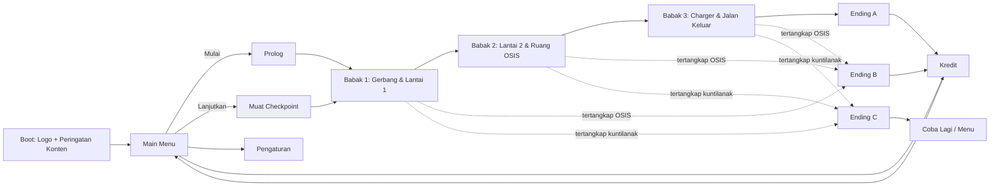
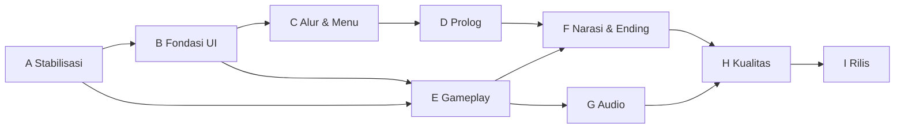

# PRD V2: Charger Diana (dari MVP ke Game Sungguhan)

> *"Cuma gara-gara charger."*

| | |
|---|---|
| **Versi** | 2.2 (nama OSIS, harga, jadwal VO terjawab) |
| **Menggantikan** | `PRD.md` v0.3 (MVP) sebagai dokumen kerja utama |
| **Engine** | Godot 4.x (.NET / C#), renderer Compatibility |
| **Platform** | PC Windows |
| **Target hardware** | Intel Celeron, RAM 8 GB, iGPU |
| **Target durasi main** | 25-35 menit (satu playthrough) |
| **Bahasa** | Indonesia (teks + voice acting) |

Dokumen terkait: `ARCHITECT.md`, `DESIGN.md`, `AGENTS.md`, `design_reference/AGENTS.md`.

---

## 1. Latar & Tujuan V2

### 1.1 Kondisi saat ini (MVP)
Berdasarkan keterangan developer, komponen dan logic inti sudah jadi dan milestone 1-10 di PRD v0.3 sudah tercapai. **Asumsi** isi MVP: gerak first-person, senter + baterai, noise system, AI OSIS dan kuntilanak dasar, hide + tahan napas, puzzle P1-P5, checkpoint, dan ending A/B/C dalam bentuk sederhana.

**Masalah yang diketahui:**
- UI dari Stitch **belum terimplementasi dengan baik** (tidak sesuai `DESIGN.md` dan referensi).
- Belum ada alur game utuh: menu, prolog, transisi, kredit.
- Konten masih sebatas bukti konsep.

> Milestone **A1** memverifikasi asumsi di atas. Kalau ada yang ternyata belum ada, masuk daftar kerja V2.

### 1.2 Definisi "Game Sungguhan"
Game dianggap sungguhan kalau pemain bisa:

1. Membuka game, melihat **peringatan konten**, masuk **main menu** yang rapi.
2. Memulai **prolog** yang membangun cerita dan motivasi Diana.
3. Memainkan **tiga babak** gameplay dengan ritme ketegangan yang terarah.
4. Mencapai salah satu dari **tiga ending**, lalu melihat **kredit**.
5. Mengatur **pengaturan** (audio, grafis, kontrol, subtitle), menjeda, menyimpan, dan melanjutkan.
6. Melakukan semuanya di laptop target **tanpa crash** dan dengan **FPS stabil**.
7. Melihat UI yang **konsisten dengan desain Stitch** dan token `DESIGN.md`.

### 1.3 Tujuan V2
- Mengubah MVP menjadi **pengalaman utuh dari boot sampai kredit**.
- **Memulihkan UI** supaya sesuai desain (lihat bagian 6).
- Memperluas konten secukupnya tanpa merusak performa dan jadwal.
- Siap dirilis (itch.io atau sejenisnya) sebagai versi 1.0.

### 1.4 Non-Tujuan V2
- Open world, multiplayer, combat, sistem crafting.
- Hantu tambahan (pocong, genderuwo): tetap di "setelah 1.0".
- Localization selain Indonesia.
- Port ke platform selain PC Windows.
- Dukungan gamepad (input hanya mouse + keyboard).
- Musik berlagu (soundtrack). Audio mengandalkan ambience dan SFX.

## 2. Prinsip Kerja V2

1. **Alur utuh dulu, polesan kemudian.** Kerjakan end-to-end berkasar, lalu perhalus.
2. **UI mengikuti desain**, bukan sebaliknya (lihat `design_reference/AGENTS.md`).
3. **Setiap milestone menghasilkan build yang bisa dimainkan.**
4. **Performa adalah fitur.** Cek FPS di Celeron setiap akhir fase.
5. **Humor hanya di Ending B.** Sisanya murni horror.
6. **Potong cakupan sebelum memotong kualitas.** Pakai prioritas Must/Should/Could (bagian 11).

## 3. Alur Game Lengkap

## 4. Spesifikasi Fitur

### 4.1 Boot & Peringatan Konten
- Layar logo singkat (maksimum 3 detik, bisa dilewati).
- **Peringatan konten:** horror, suara keras mendadak, jumpscare, efek lampu berkedip (potensi sensitif cahaya).
- Opsi "Kurangi efek berkedip" tersedia di Pengaturan dan ditawarkan di layar ini.
- Pemuatan aset awal di balik layar ini supaya menu langsung responsif.

### 4.2 Main Menu
- Latar: siluet sekolah malam dengan satu jendela menyala, grain, sedikit gerak (lampu berkedip lambat, angin).
- Item: **MULAI**, **LANJUTKAN** (nonaktif bila belum ada save), **PENGATURAN**, **KREDIT**, **KELUAR**.
- Navigasi: mouse dan keyboard (panah/WASD, Enter, Esc). Tanpa gamepad.
- Audio menu: ambience sunyi + dengung lampu, tawa jauh sesekali (jarang). Tanpa musik berlagu.
- Konfirmasi saat memilih MULAI jika sudah ada save ("Mulai baru akan menimpa save?").
- Visual mengikuti `design_reference/screens/main_menu/`.

### 4.3 Prolog (±2-3 menit, bisa dilewati setelah pertama kali)
**Tujuan:** menanamkan motivasi receh Diana dengan serius, lalu mengubah nada ke tegang.

Alur (in-engine, semi-interaktif, tanpa video terpisah):

| Adegan | Isi | Interaksi |
|---|---|---|
| P-1 Kamar Diana (22:30) | Diana rebahan, HP 35%. Cari charger di tas, tidak ada. Cek laci: hanya ada kabel tanpa adaptor dan casan model lain yang tidak cocok. Tidak punya casan cadangan | Pemain jalan kecil, cek tas, laci |
| P-2 Chat HP | Pesan dari teman: charger kemungkinan tertinggal di kelas. Teman menyebut kunci cadangan "biasanya di bawah pot dekat pos satpam" (menanam petunjuk P1) | Buka HP, baca chat |
| P-3 Keputusan | Diana sadar HP adalah segalanya baginya dan tidak ada casan lain. Memutuskan pergi. Monolog singkat (VO) | Ambil jaket, keluar kamar |
| P-4 Perjalanan | Jalan kaki malam ke sekolah: jalan sepi, anjing menggonggong jauh, lampu jalan berkedip | Berjalan lurus, tanpa bahaya (urutan sinematik ringan) |
| P-5 Gerbang | Gerbang terkunci, sekolah gelap | Transisi ke Babak 1 |

Catatan:
- **Motivasi Diana (keputusan):** tidak ada alasan khusus seperti "besok ada hal penting". Diana anak Gen Z yang selalu butuh HP, dan dia tidak punya casan lain. Motivasi sengaja dibuat receh supaya cocok dengan punchline judul, tapi dimainkan serius (Diana benar-benar panik, bukan bercanda). Prolog tidak perlu menjelaskan lebih jauh.
- Prolog **tidak boleh bunuh pemain** dan tidak punya musuh. Bangun suasana saja.
- Tombol **Lewati** (tahan 1 detik) tersedia.
- Prolog juga berfungsi sebagai **tutorial gerak dan interaksi** yang halus.

### 4.4 Gameplay: Tiga Babak

| Babak | Zona | Fokus | Puzzle | Ketegangan |
|---|---|---|---|---|
| **1. Masuk** | Gerbang, halaman, lobi, lantai 1 | Pengenalan mekanik, suasana | P1 masuk, P2 listrik | Rendah ke sedang. Kuntilanak hanya terdengar |
| **2. Naik** | Tangga, lantai 2, ruang OSIS | Patroli OSIS jadi ancaman utama, penampakan pertama kuntilanak | P3 kunci kelas | Sedang ke tinggi |
| **3. Keluar** | Kelas Diana, lab/perpustakaan, rute keluar | Kuntilanak Hunting, kabur | P4 charger, P5 jalan keluar | Tinggi, klimaks |

**Konten tambahan dibanding MVP (prioritas Should):**
- Ruangan tambahan yang bisa dijelajahi: toilet, UKS, kantin, ruang guru, lab.
- **2-3 puzzle tambahan** berukuran kecil (misalnya mengatur ulang urutan lampu di lab, mencari bagian kunci yang terpisah).
- **Catatan lore** tersembunyi tentang asal kuntilanak (pohon lama di belakang lab, kejadian lama di sekolah).
- **Event terskrip** per babak (lampu padam, pintu tertutup sendiri, suara dari kelas kosong).
- **Tutorial kontekstual:** petunjuk muncul sesuai situasi dan hanya sekali (misalnya "[Ctrl] Jongkok" saat OSIS pertama lewat).

### 4.5 Musuh V2

**Kuntilanak**
- Encounter terskrip di tiap babak, makin intens.
- Telegraph konsisten: tawa terbalik, bau melati, lampu berkedip.
- Variasi suara tawa dan bisikan (5-8 variasi).
- Aturan harus tetap adil dan bisa dipelajari.

**OSIS Patroli (karakter bernama)**
- 3 anggota: **Cecillia, Adam, dan Ferdi** (nama final). Sifat singkat tiap karakter ditentukan di milestone E5.
- Dialog HT dan seruan saat curiga/kejar (VO). Ketiga anggota diisi suara oleh developer sendiri, jadi bedakan karakter lewat nada, tempo, dan filter radio HT.
- Rute berbeda per babak.
- Reaksi ketakutan ke kuntilanak tetap serius.

### 4.6 Ending

| Ending | Pemicu | Nada | Isi |
|---|---|---|---|
| **A** | Keluar gerbang dengan charger | Tenang, lega | Sekuens singkat, layar akhir, kredit |
| **B** | Tertangkap OSIS | **Humor** (satu-satunya) | Dialog "cuma buat charger?", layar "TAMAT?", kredit |
| **C** | Tertangkap kuntilanak | Murni horror | Sekuens singkat, layar game over, coba lagi/menu |

**Could:** Ending D (rahasia), terbuka jika pemain mengumpulkan seluruh catatan lore. Hanya dikerjakan jika semua Must/Should selesai.

### 4.7 Sistem Pendukung

| Sistem | Spesifikasi |
|---|---|
| **Save/Load** | Auto-save di checkpoint, satu slot. LANJUTKAN memuat checkpoint terakhir |
| **Pause** | Esc, game benar-benar berhenti, audio ambience diredam |
| **Pengaturan** | Volume (Utama, SFX, Ambience, VO), subtitle on/off + ukuran, kecerahan, preset grafis, efek retro, kurangi kedip, sensitivitas mouse, rebind kontrol |
| **Preset grafis** | **Rendah / Sedang / Tinggi** yang mengatur Scaling 3D, bayangan senter, shader PS1, jumlah lampu |
| **Subtitle** | Sinkron dengan VO, nama pembicara berwarna sesuai token |
| **Loading** | Layar loading ringan dengan teks atmosfer (bukan tip game) |
| **Kredit** | Gulir pelan, mencantumkan semua aset berlisensi dan pengisi suara |
| **Log & crash** | Log tertulis ke `user://logs/` untuk mempermudah debugging dari playtester |
| **Statistik ringan** | Opsional: waktu main dan jumlah mati di layar akhir |

### 4.8 Audio
- **Ambience** per zona (3-5 lapisan yang dicampur sesuai lokasi).
- **SFX** lengkap: langkah di berbagai permukaan, pintu, loker, saklar, HP.
- **VO:** Diana diisi teman, OSIS (3 karakter) diisi developer sendiri, tawa/bisikan kuntilanak belum diputuskan. Disinkron ke subtitle. Catatan produksi ada di milestone G2.
- **Tanpa musik berlagu.** Audio mengandalkan ambience dan beberapa SFX stinger di momen kunci (charger diambil, klimaks, ending).
- **Ducking:** VO menurunkan ambience otomatis.
- Semua audio berlisensi jelas dan dicatat untuk kredit.

### 4.9 Efek & Visual
- Gaya PS1 konsisten di semua zona: tekstur kecil, filter nearest, vertex snapping (opsional via preset).
- Overlay grain/dithering/vignette sebagai shader terpisah, bisa dimatikan.
- Fog linear pendek di tiap zona.
- Pencahayaan: bayangan mati kecuali senter pada preset Sedang ke atas.

## 5. Persyaratan Non-Fungsional

| Aspek | Target |
|---|---|
| FPS | 30 stabil minimum di Celeron/8 GB (preset Rendah), 45+ ideal |
| Memori | < 1.5 GB saat bermain |
| Waktu load | Menu ke gameplay < 15 detik |
| Ukuran build | < 500 MB (VO dikompres OGG mono) |
| Stabilitas | Tidak ada crash pada satu playthrough penuh |
| Resolusi | Dukung 1366x768, 1600x900, 1920x1080 dengan UI yang skala benar |
| Input | Keyboard + mouse saja (tanpa gamepad) |
| Aksesibilitas | Subtitle, opsi kurangi kedip, rebind kontrol, peringatan konten |

## 6. Rencana Pemulihan UI (Stitch)

### 6.1 Diagnosis
UI MVP tidak mengikuti desain. Pemulihan dilakukan **berurutan dari fondasi ke layar**, bukan layar-per-layar secara acak, supaya perbaikan tidak berulang.

### 6.2 Urutan Pemulihan
1. **Audit** (A3): bandingkan tiap layar MVP dengan referensi, hasilnya laporan celah per layar.
2. **Fondasi** (B1-B3): Theme tunggal, font, token warna, stretch/skala, overlay efek.
3. **Komponen bersama** (B2): bangun sekali, dipakai di mana-mana.
4. **Layar demi layar** (C, D, F): tiap layar dikerjakan sesuai `design_reference/AGENTS.md`.
5. **Parity pass akhir** (H3): cek ulang semua layar sebelum rilis.

### 6.3 Komponen Bersama

| Komponen | Dipakai di |
|---|---|
| `MenuButton` (gaya "> " terpilih, merah) | Menu, pause, pengaturan, layar akhir |
| `BatteryIndicator` (normal biru, rendah kuning) | HUD, layar HP, intro |
| `StaminaBar` tipis | HUD |
| `InteractPrompt` | HUD |
| `SubtitleBox` (outline gelap 2 px) | HUD, prolog, ending |
| `NoteSheet` (kertas lusuh) | Pembaca catatan |
| `DialogueBox` | Ending B, prolog |
| `SettingRow` (slider blok piksel, toggle ON/OFF) | Pengaturan |
| `ScreenFader` | Semua transisi |

### 6.4 Matriks Layar

| Layar | Scene | Prioritas | Kriteria parity |
|---|---|---|---|
| Main Menu | `MainMenu.tscn` | Must | Layout, judul, item menu, ikon baterai kecil sesuai referensi |
| HUD | `Hud.tscn` | Must | Baterai, stamina tipis, prompt, subtitle; tidak ada panel membulat |
| Layar HP | `PhoneUi.tscn` | Must | Jam, baterai, ikon senter/catatan, grid catatan, pratinjau chat |
| Pembaca Catatan | `NoteReader.tscn` | Must | Kertas miring, tape, font mesin ketik, hint "[E] Tutup" |
| Pause | `PauseMenu.tscn` | Must | Kolom sempit, border 1 px, item sesuai copywriting |
| Pengaturan | `Settings.tscn` | Must | Slider blok, toggle, hint bawah |
| Game Over (C) | `GameOver.tscn` | Must | Teks merah tunggal, siluet nyaris tak terlihat |
| Ending A | `EndingA.tscn` | Must | Teks, ikon baterai 1% + petir kecil |
| Ending B | `EndingB.tscn` | Must | Kotak dialog piksel, "TAMAT?" merah |
| Intro/Judul Adegan | `Intro.tscn` | Should | Teks jam + HP, tanpa elemen lain |
| Kredit | `Credits.tscn` | Should | Gulir, font UI, palet token |
| Peringatan Konten | `ContentWarning.tscn` | Must | Teks jelas, kontras tinggi |

### 6.5 Definisi "UI Parity" (kriteria lulus)
Sebuah layar dianggap sesuai bila:
- [ ] Struktur dan hierarki sama dengan screenshot referensi (bukan piksel-per-piksel)
- [ ] Hanya memakai 6 warna token, satu aksen merah
- [ ] Font benar (VT323 UI, Special Elite catatan, Rock Salt judul)
- [ ] Sudut tajam, border 1-2 px, tanpa gradien/glow/blur
- [ ] Semua teks adalah `Label` (tidak ada teks "dipanggang")
- [ ] Teks bahasa Indonesia sesuai copywriting
- [ ] Skala benar di 1366x768, 1600x900, 1920x1080
- [ ] Gaya berasal dari Theme, bukan override per node
- [ ] Laporan "diambil/diabaikan/dikoreksi" ditulis (format di `design_reference/AGENTS.md`)

## 7. Milestone

Ukuran: **S** = kecil, **M** = sedang, **L** = besar. Prioritas: **Must / Should / Could**.

### Fase A: Stabilisasi & Audit

| ID | Milestone | Deliverable & kriteria selesai | Uk. | Pri. |
|---|---|---|---|---|
| A1 | Audit MVP | Daftar fitur yang ada vs PRD, daftar bug, baseline FPS di Celeron | S | Must |
| A2 | Rapikan & tuning | Nilai tuning dipindah ke `[Export]`/Resource, hapus placeholder, build bersih tanpa warning baru | M | Must |
| A3 | Audit UI vs Stitch | Laporan celah per layar (matriks 6.4) dengan skor dan daftar perbaikan | S | Must |

### Fase B: Fondasi UI

| ID | Milestone | Deliverable & kriteria selesai | Uk. | Pri. |
|---|---|---|---|---|
| B1 | Theme & token | `ui_theme.tres` dengan font, 6 warna, StyleBox sudut 0; stretch `canvas_items`, skala diuji di 3 resolusi | M | Must |
| B2 | Komponen bersama | Komponen di tabel 6.3 sebagai scene reusable, dipakai oleh HUD yang diperbaiki | M | Must |
| B3 | Overlay efek | Shader grain/dither/vignette ringan, toggle, biaya GPU diukur | S | Should |

### Fase C: Alur & Menu

| ID | Milestone | Deliverable & kriteria selesai | Uk. | Pri. |
|---|---|---|---|---|
| C1 | Boot & peringatan konten | Logo, peringatan, opsi kurangi kedip, transisi ke menu | S | Must |
| C2 | Main Menu | Sesuai referensi, navigasi keyboard/mouse, LANJUTKAN nonaktif tanpa save, konfirmasi MULAI baru | M | Must |
| C3 | Pengaturan | Semua opsi 4.7 berfungsi dan tersimpan di `user://settings.cfg` | L | Must |
| C4 | Pause, save & load | Pause menyeluruh, LANJUTKAN memuat checkpoint terakhir, auto-save andal | M | Must |
| C5 | Rebind kontrol | Pengguna bisa mengubah tombol, deteksi konflik | M | Should |

### Fase D: Prolog

| ID | Milestone | Deliverable & kriteria selesai | Uk. | Pri. |
|---|---|---|---|---|
| D1 | Naskah & storyboard | Naskah prolog (adegan P-1 sampai P-5) dengan motivasi "selalu butuh HP, tak punya casan lain", daftar baris VO | S | Must |
| D2 | Kamar & chat HP | Scene kamar, interaksi tas/laci, chat HP yang menanam petunjuk P1 | M | Must |
| D3 | Perjalanan & gerbang | Sekuens jalan ke sekolah, transisi mulus ke Babak 1, tombol lewati | M | Must |

### Fase E: Gameplay Penuh

| ID | Milestone | Deliverable & kriteria selesai | Uk. | Pri. |
|---|---|---|---|---|
| E1 | Level pass | Semua zona selesai (geometri + tekstur PS1), navmesh baik, tanpa lubang atau jalan buntu | L | Must |
| E2 | Tutorial kontekstual | Hint muncul sekali sesuai situasi, tidak mengganggu | S | Should |
| E3 | Puzzle pass | P1-P5 dipoles, ditambah 2-3 puzzle kecil, semua bisa diselesaikan dari save | M | Must |
| E4 | Kuntilanak V2 | Encounter terskrip per babak, variasi tawa, telegraph konsisten, aturan adil | L | Must |
| E5 | OSIS V2 | 3 karakter bernama, rute per babak, HT chatter, panik ke kuntilanak | M | Must |
| E6 | Catatan & lore | Semua catatan, galeri HP lengkap, lore asal kuntilanak | M | Should |
| E7 | Pacing & balancing | Kurva ketegangan terukur, tuning baterai/stamina/AI, tidak ada jalan buntu soft-lock | M | Must |

### Fase F: Narasi & Ending

| ID | Milestone | Deliverable & kriteria selesai | Uk. | Pri. |
|---|---|---|---|---|
| F1 | Sekuens ending A/B/C | Tiap ending punya adegan, transisi, layar akhir sesuai referensi | M | Must |
| F2 | Kredit | Layar kredit lengkap (aset, lisensi, pengisi suara) | S | Should |
| F3 | Ending D (rahasia) | Terbuka jika semua catatan dikumpulkan | M | Could |

### Fase G: Audio

| ID | Milestone | Deliverable & kriteria selesai | Uk. | Pri. |
|---|---|---|---|---|
| G1 | Ambience & SFX | Ambience per zona, SFX lengkap, bus & ducking | M | Must |
| G2 | Voice acting | Naskah VO final dibagi per pengisi (Diana: teman, OSIS: developer), rekaman, pembersihan, kompres OGG mono, integrasi, subtitle sinkron | L | Should |
| G3 | SFX momen kunci | Beberapa stinger SFX (charger diambil, klimaks, ending), tanpa musik berlagu | S | Should |

### Fase H: Kualitas & Performa

| ID | Milestone | Deliverable & kriteria selesai | Uk. | Pri. |
|---|---|---|---|---|
| H1 | Performa pass | Preset grafis, culling, lightmap bila perlu; target FPS tercapai di Celeron | M | Must |
| H2 | Build & export | Preset export Windows, versioning, log ke file, ukuran build sesuai target | S | Must |
| H3 | UI parity pass | Semua layar lulus daftar 6.5 | M | Must |
| H4 | Playtest 1 | 3-5 penguji, form umpan balik, daftar bug dan keluhan | M | Must |
| H5 | Perbaikan & Playtest 2 | Bug terprioritaskan diperbaiki, uji ulang | L | Must |
| H6 | Release candidate | Satu playthrough penuh tanpa crash pada build final | S | Must |

### Fase I: Rilis

| ID | Milestone | Deliverable & kriteria selesai | Uk. | Pri. |
|---|---|---|---|---|
| I1 | Persiapan rilis | Halaman itch.io (deskripsi, screenshot, tag horror, peringatan konten, harga "bayar sesukamu"), paket build Windows (zip), catatan versi | S | Must |
| I2 | Rilis 1.0 | Build publik diunggah, jalur pelaporan bug | S | Must |
| I3 | Trailer pendek | 30-60 detik, rekaman gameplay | S | Could |

### Urutan & Ketergantungan

Fase **C-D** (alur UI) dan **E** (gameplay) boleh dikerjakan bergantian supaya tidak jenuh, selama fase **B** selesai lebih dulu.

## 8. Metrik Keberhasilan

| Metrik | Target |
|---|---|
| Penyelesaian | Penguji bisa menamatkan game tanpa bantuan |
| Stabilitas | 0 crash pada playthrough penuh |
| Performa | FPS >= 30 di Celeron pada preset Rendah |
| Kejelasan | Penguji paham tujuan dan aturan musuh tanpa penjelasan lisan |
| UI | 100% layar Must lulus daftar UI parity |
| Ketegangan | Mayoritas penguji menyebut game "menegangkan" |
| Humor | Ending B dinilai lucu tanpa merusak nada horror |

## 9. Risiko

| Risiko | Dampak | Mitigasi |
|---|---|---|
| Scope creep (V2 jauh lebih besar dari MVP) | Tidak selesai | Pakai Must/Should/Could, potong Could dulu |
| Performa Celeron turun saat konten bertambah | Game tidak layak main | Preset grafis, cek FPS tiap akhir fase |
| UI kembali melenceng dari desain | Kerja ulang | Theme tunggal, komponen bersama, parity checklist, aturan di `design_reference/AGENTS.md` |
| VO molor atau kualitas tidak merata | Jadwal mundur | VO lapisan terakhir, game tetap jalan tanpa VO |
| Teman pengisi suara Diana tidak tersedia atau jadwal bentrok | VO Diana tertunda | Finalkan naskah VO lebih dulu, rekam dalam satu sesi pendek, siapkan mode subtitle saja sebagai cadangan |
| Soft-lock di puzzle | Pemain macet | Checkpoint rapat, uji penyelesaian dari tiap save |
| AI terasa tidak adil | Frustrasi | Telegraph wajib, alert meter, playtest |
| Burnout (proyek santai jadi berat) | Berhenti | Fase bergantian, rilis bertahap (menu/prolog dulu), boleh jeda antar fase |
| Lisensi aset audio/tekstur tidak jelas | Masalah rilis | Catat sumber dan lisensi tiap aset sejak awal |
| Build C# lambat di Celeron | Iterasi lambat | Kelompokkan perubahan, uji logika murni terpisah |

## 10. Rencana Pengujian

- **Uji internal** tiap akhir milestone: checklist manual singkat.
- **Uji performa** tiap akhir fase: export build, ukur FPS di zona terberat.
- **Uji alur penuh** (boot ke kredit) minimal sekali per fase setelah fase D.
- **Playtest H4/H5:** 3-5 teman, tanpa penjelasan, rekam kesulitan dan momen bingung, form singkat (mudah, tegang, bingung di mana, bug).
- **Uji penyelesaian dari tiap save/checkpoint** untuk memastikan tidak soft-lock.
- **Uji resolusi:** 1366x768, 1600x900, 1920x1080.

## 11. Prioritas Cakupan

**Must (inti 1.0):** boot + peringatan, main menu, pengaturan, pause/save/load, prolog, tiga babak, tiga ending, UI parity, audio dasar, performa, playtest, rilis.

**Should:** voice acting, SFX momen kunci, catatan lore, tutorial kontekstual, kredit lengkap, rebind kontrol, overlay efek.

**Could:** Ending D, trailer, statistik ringan, mode "Santai".

**Aturan potong:** bila jadwal mepet, buang dari bawah (Could, lalu Should) sebelum mengurangi kualitas Must.

## 12. Dampak ke Dokumen Lain

Setelah PRD V2 disetujui, dokumen berikut perlu disesuaikan:

| Dokumen | Perubahan |
|---|---|
| `AGENTS.md` | Ganti rujukan `PRD.md` ke `PRD_V2.md`; tambah aturan alur game dan penyimpanan pengaturan |
| `ARCHITECT.md` | Tambah: `SceneManager` (alur boot/menu/prolog/gameplay), `SettingsManager`, `SaveSystem` lengkap, sistem preset grafis, `CutsceneController` |
| `DESIGN.md` | Tambah layar baru: Peringatan Konten, Kredit, Loading, dan variasi Pengaturan; perbarui prompt Stitch |
| `design_reference/` | Tambah folder layar baru beserta `notes.md` |

## 13. Keputusan & Pertanyaan Terbuka

### Keputusan (sudah dijawab)

| Topik | Keputusan |
|---|---|
| Motivasi prolog | Tidak ada alasan "besok penting". Diana Gen Z selalu butuh HP dan tidak punya casan lain |
| Voice acting | Teman mengisi Diana, developer mengisi 3 anggota OSIS |
| Musik | Tidak ada. Ambience + beberapa SFX saja |
| Distribusi | itch.io, harga "bayar sesukamu" (pay what you want) |
| Jadwal rekaman VO teman | Diatur sendiri oleh developer |
| Nama anggota OSIS | Cecillia, Adam, Ferdi. Semua diisi suara developer |
| Durasi target | 25-35 menit, sudah optimal |
| Input | Mouse + keyboard saja, tanpa gamepad |

### Pertanyaan terbuka (sisa)

1. **Suara kuntilanak** (tawa, bisikan, tangis): diisi developer, teman, atau cukup sampel SFX? Belum diputuskan. Tidak memblokir milestone apa pun sebelum G2, jadi boleh dijawab nanti.
