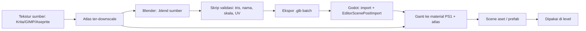
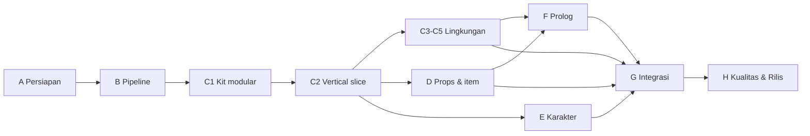

# PRD V3: Charger Diana (Produksi Asset 3D)

> *"Dari kotak abu-abu jadi sekolah beneran."*

| | |
|---|---|
| **Versi** | 3.1 (pertanyaan terbuka terjawab, disesuaikan untuk pemula Blender) |
| **Melanjutkan** | `PRD_V2.md` (semua milestone Must selesai) |
| **Fokus** | Produksi asset 3D: modeling, tekstur, rigging, animasi, dan pipeline Blender ke Godot |
| **Tools utama** | Blender (modeling, UV, rig, animasi), Godot 4.x (.NET / C#), format tukar glTF 2.0 (`.glb`) |
| **Target hardware** | Intel Celeron, RAM 8 GB, iGPU (berlaku untuk **game dan Blender**) |
| **Gaya visual** | PS1 / horror Indonesia: low-poly, tekstur kecil, filter nearest |

Dokumen terkait: `PRD_V2.md`, `ARCHITECT.md`, `DESIGN.md`, `AGENTS.md`, `design_reference/AGENTS.md`, dan dokumen baru `ART_BIBLE.md` (dibuat di milestone A3).

---

## 1. Latar & Tujuan V3

### 1.1 Kondisi saat ini
PRD V2 sudah membuat game utuh dari boot sampai kredit. Milestone E1 (Level pass) di V2 menghasilkan geometri dan tekstur yang cukup untuk dimainkan.

> **Asumsi (diverifikasi di milestone A2):** isi level saat ini masih bersifat *sementara*, yaitu bentuk dasar (greybox), model bawaan Godot, atau aset seadanya. Karakter (kuntilanak dan OSIS) kemungkinan masih berupa model sederhana atau placeholder. Kalau ternyata sebagian sudah rapi, A2 mencatatnya dan bagian itu dikeluarkan dari daftar kerja V3.

**Masalah yang ingin diselesaikan:**
- Dunia game belum terasa seperti "sekolah malam" yang sungguhan, masih terasa seperti prototipe.
- Belum ada standar skala, poligon, tekstur, dan penamaan, sehingga aset berisiko tidak konsisten.
- Belum ada alur kerja Blender ke Godot yang rapi dan bisa diulang.
- Mesin target lemah. Aset yang terlalu berat akan menjatuhkan FPS di Celeron.

### 1.1.1 Perubahan Pipeline (A1 - 2026-10-13)
**Blender tidak layak di laptop target (Celeron N4020).** A1 menguji dan hasilnya: Blender sangat lambat, sistem force clone saat dibuka.

**Keputusan:** Pipeline diubah dari "Blender → glTF → Godot" menjadi "Download CC0 → Import Godot → Edit di Godot".
- **Sumber aset:** Kenney + Poly Haven (CC0 tanpa atribusi).
- **Tanpa Blender:** Tidak ada modeling dari nol, tidak ada UV editing di Blender.
- **Editing di Godot:** Skala, material (ganti ke PS1/atlas), collision dibuat manual di Godot.
- **Catatan:** Ini menyimpang dari rencana awal "model dibuat sendiri", tapi adalah satu-satunya opsi yang layak di hardware target. Risiko: gaya visual mungkin kurang konsisten, akan di-mitigasi dengan palet dan material PS1 yang seragam.

### 1.2 Definisi "Asset Set Selesai"
Set aset dianggap selesai bila:

1. Semua zona di tiga babak dan prolog bisa dibangun dari **aset CC0 yang diedit** (bukan placeholder) dengan gaya seragam.
2. **Kuntilanak**, **tiga anggota OSIS (Cecillia, Adam, Ferdi)**, dan item puzzle utama (terutama **charger**) punya model final dan animasi yang dibutuhkan game.
3. Semua aset lolos **gerbang kualitas** (bagian 9): skala, pivot, budget poligon, tekstur, penamaan.
4. Alur **CC0 ke Godot** berjalan terukur: download `.glb`, import, edit material/collision di Godot.
5. Game tetap memenuhi target V2: **30 FPS stabil di Celeron/8 GB (preset Rendah)**, memori < 1.5 GB, build < 500 MB.
6. Playtest menilai tampilan "konsisten dan menyeramkan" tanpa terasa seperti kumpulan aset campur aduk.

### 1.3 Tujuan V3
- Mengganti seluruh placeholder menjadi aset CC0 gaya PS1 yang konsisten.
- Membangun **modular kit** sekolah supaya satu set potongan bisa menyusun banyak ruangan (atau pakai aset CC0 yang sudah modular).
- Menetapkan **standar teknis** (budget, skala, tekstur, penamaan) dan **pipeline CC0 ke Godot** yang bisa diulang.
- Menjaga performa: setiap fase diukur di Celeron.

### 1.4 Non-Tujuan V3
- Model high-poly, sculpting, baking normal map, PBR penuh.
- Rambut/kain simulasi, fisika karakter, motion capture.
- Hantu tambahan (pocong, genderuwo) dan karakter baru di luar yang ada di V2.
- Mengubah cakupan gameplay V2. V3 hanya soal **tampilan dan aset**.
- Rendering tingkat tinggi (Cycles, ray tracing). Blender dipakai sebagai alat modeling, bukan renderer.
- Port ke platform selain PC Windows.

### 1.5 Titik Awal: Pemula Total di Blender

Developer **belum pernah memakai Blender sama sekali** (keputusan Q1). Ini mengubah cara V3 dijalankan:

- **Belajar adalah milestone tersendiri (A0)**, bukan sesuatu yang "nanti juga bisa". A0 selesai ketika satu prop sederhana lolos pipeline end-to-end, dari Blender sampai tampil benar di Godot.
- **Urutan produksi dari yang paling mudah ke paling sulit:** potongan modular (hampir semuanya kotak) → furnitur → props → item → zona khusus → **karakter paling akhir** (rigging dan animasi adalah bagian tersulit).
- **Gaya PS1 yang kotak-kotak justru menguntungkan pemula.** Bentuk sederhana, poligon sedikit, detail dari tekstur.
- **Belajar sambil membuat.** Tiap kelompok aset baru memperkenalkan satu teknik baru, bukan tutorial panjang di depan.
- **Gerbang belajar:** milestone produksi hanya dimulai setelah level kemampuan yang dibutuhkan tercapai.

| Level | Kemampuan | Dibutuhkan untuk |
|---|---|---|
| L0 | Navigasi viewport, pindah/putar/skala objek, Object Mode vs Edit Mode, simpan dan autosave | A1, A0 |
| L1 | Box modeling: extrude, inset, loop cut, bevel sederhana, merge, Mirror modifier | C1, D1 |
| L2 | UV unwrap, menempel atlas, menjaga texel density, vertex color | B3, C1 |
| L3 | Apply transform, penamaan, ekspor `.glb`, impor ke Godot, sufiks collision | A0, B2 |
| L4 | Modular: snap ke grid 2 m, pivot yang benar, duplikasi/array | C1, C3 |
| L5 | Armature, parent dengan *Automatic Weights*, weight paint dasar | E1, E3 |
| L6 | Pose dan keyframe dasar, retarget animasi di Godot (BoneMap) | E2, E4, E5 |

**Sumber belajar:** materi resmi dan gratis dari blender.org (seri *Blender Fundamentals*), ditambah video tutorial low-poly gratis. Selama pengerjaan, agent/Claude memandu langkah demi langkah per aset (hotkey, menu, hasil yang seharusnya terlihat).

**Tips khusus laptop:** di Preferences, Input, aktifkan **Emulate Numpad** (laptop tanpa numpad) dan **Emulate 3 Button Mouse** (touchpad). Mouse eksternal sangat disarankan.

**Ekspektasi yang jujur:** aset-aset awal akan lambat dibuat dan kualitasnya naik seiring waktu. Karena itu vertical slice (C2) ditunda sampai L0-L4 tercapai, dan Should/Could menjadi katup pengaman. Bila karakter (E1/E3) macet, ada rencana cadangan (lihat bagian 13 dan pertanyaan terbuka 14).

## 2. Prinsip Kerja V3

1. **Modular dulu, unik kemudian.** Bangun potongan yang bisa dipakai ulang sebelum aset sekali pakai.
2. **Budget sebelum model.** Tentukan batas poligon dan tekstur lebih dulu, lalu modeling.
3. **Vertical slice dulu.** Satu ruangan selesai penuh (milestone C2) sebelum memproduksi massal. Gaya dan performa dibuktikan di sana.
4. **Aset hanya dibuat bila dipakai.** Setiap aset harus tercantum di katalog (bagian 5) dan punya tempat di level.
5. **Ekspor harus membosankan.** Pipeline otomatis supaya waktu habis untuk modeling, bukan mengurus file.
6. **Performa adalah fitur**, termasuk performa Blender di laptop target. Alur kerja menyesuaikan mesin, bukan sebaliknya.
7. **Potong cakupan sebelum memotong konsistensi.** Pakai prioritas Must/Should/Could (bagian 12).
8. **Belajar sambil membuat.** Kemampuan Blender naik bertahap (bagian 1.5). Jangan meminta teknik di atas level yang sudah tercapai.

## 3. Gaya Visual & Budget Teknis (Art Bible 3D)

Nilai di bawah adalah **titik awal**. Milestone **A3** menetapkan versi final di `ART_BIBLE.md`, dan **C2** (vertical slice) memvalidasinya di Celeron.

### 3.1 Gaya
- **Low-poly bersudut**, siluet jelas, detail dari tekstur bukan dari geometri.
- Tekstur kecil dengan filter nearest. Boleh sedikit "kotor" dan berpiksel.
- Tanpa normal map dan tanpa PBR. Shader PS1 dari V2 (vertex snapping dan sebagainya) dipakai sebagai material standar.
- Pencahayaan "dipalsukan" lewat **vertex color / AO yang dibaking ke vertex color** di sudut dan kolong, supaya murah di iGPU.
- Suasana: lembap, kusam, neon sekolah yang hampir mati, noda, kertas berserakan. Palet 3D per zona dijaga muram. (Palet 3D terpisah dari 6 token UI di `DESIGN.md`.)

### 3.2 Skala & Satuan
- **1 unit Blender = 1 meter** (Unit Scale 1.0). Sumbu ekspor glTF: +Y Up.
- Tinggi pintu 2.0 m, tinggi meja siswa sekitar 0.75 m, tinggi pemain mengikuti pengaturan di Godot.
- **Grid modul 2 m** untuk dinding, lantai, dan plafon. Ketinggian lantai ke plafon sekolah dibakukan di A3.
- Pivot (origin): di dasar objek untuk props dan furnitur, di sudut untuk potongan modular.

### 3.3 Budget Poligon (segitiga/tris)

| Kategori | Budget per aset | Catatan |
|---|---|---|
| Prop kecil (buku, baterai, kunci, charger) | 30-200 | Charger dan HP boleh ke ~300 karena dilihat dekat |
| Prop sedang (tas, ember, tempat sampah) | 100-500 | |
| Furnitur (meja, kursi, loker, papan tulis) | 150-800 | Kursi/meja siswa dipakai berkali-kali, buat se-hemat mungkin |
| Potongan modular (dinding, lantai, pintu) | 12-100 | Pakai ulang di semua zona |
| Prop lingkungan luar (pohon lama, lampu jalan) | 300-1.500 | Pohon lama = aset "hero", boleh lebih |
| **Kuntilanak** | 1.500-2.500 | Rambut dan gaun dari bidang sederhana |
| **OSIS (per karakter)** | 800-1.500 | Satu basis tubuh dipakai bersama, tiga variasi |
| **Tangan Diana + HP** (first-person) | 300-600 total | Keputusan Q3: tanpa badan penuh |

Budget per scene (titik awal): **terlihat sekaligus ≤ ~40.000 tris**, **material aktif ≤ ~20**, **draw call ≤ ~150**. Dicek di C2 dan diukur ulang tiap akhir fase.

### 3.4 Tekstur
- **Texel density tetap**: sekitar **64 px per meter** (disesuaikan di A3).
- Ukuran: atlas per kategori/zona **maksimum 256x256**, atlas "hero" maksimum 512x512. Kelipatan 2.
- Satu **atlas per kelompok** (arsitektur sekolah, furnitur, props, luar ruangan, karakter) untuk menekan jumlah material dan draw call.
- Filter nearest, mipmap diputuskan lewat uji di B3.
- Tekstur dilukis di **Krita** (gratis) atau diolah dari sumber **CC0** lalu **diturunkan resolusinya** dan dikurangi warnanya (posterize) supaya cocok dengan gaya. Sumber CC0 yang disarankan untuk tekstur/material: ambientCG, Poly Haven. Hanya **tekstur/material** yang boleh dari luar, **model tetap dibuat sendiri** (keputusan Q2). Sumber dan lisensi dicatat di `assets/ASSETS.md`.
- Estimasi total tekstur dalam build di bawah ~100 MB, model di bawah ~50 MB. (Titik awal, dikunci di A3.)

## 4. Pipeline Blender ke Godot



### 4.1 Blender di laptop target (kritis)
Blender sendiri berat untuk Celeron. Persyaratan resmi Blender 5.x yang dirangkum situs referensi: **4 core CPU dengan SSE4.2, 8 GB RAM, GPU 2 GB VRAM dengan OpenGL 4.3**, dan 5.0 menambah Vulkan 1.3 (kembali ke OpenGL bila tidak ada). Blender 4.5 LTS masih mendapat perbaikan sampai sekitar Juli 2027.

Karena spesifikasi persisnya belum diketahui (jumlah core Celeron, versi OpenGL iGPU), **milestone A1 menguji dan memutuskan versi Blender**:

| Skenario hasil uji A1 | Keputusan |
|---|---|
| Blender versi terbaru (5.x LTS) jalan lancar | Pakai versi itu |
| Gagal buka / sangat lambat | Pakai **4.5 LTS**, lalu **3.6 LTS** bila OpenGL 4.3 tidak ada |
| Tidak ada yang layak | Cari alternatif kerja (laptop lain/teman, atau aset dari sumber CC0 + penyuntingan ringan). Dicatat sebagai risiko tinggi |

**Pengaturan kerja hemat sumber daya (default semua file template):**
- Viewport mode **Solid** (Workbench), bukan Material Preview/Rendered. Matikan anti-aliasing viewport berlebih.
- Tanpa Subdivision Surface, tanpa sculpt, tanpa simulasi. Pakai Mirror modifier (lalu di-apply) untuk objek simetris.
- Batasi Undo Steps (16-32), simpan sering, aktifkan autosave, tutup aplikasi berat lain saat bekerja.
- Kerjakan **satu aset per file kecil** (atau satu kelompok kecil), bukan satu file raksasa berisi seluruh sekolah.
- Uji coba Godot di editor sambil Blender tertutup bila RAM mepet.
- Aktifkan **Emulate Numpad** dan **Emulate 3 Button Mouse** (Preferences, Input) bila memakai laptop dengan touchpad.

### 4.2 Struktur Folder

```
art/                      # sumber, repo terpisah (charger-diana-art), TIDAK masuk build/repo game
├─ blend/ {arch, furniture, props, characters, outdoor, prolog}/
├─ textures_src/          # file kerja tekstur (Krita/GIMP/Aseprite)
├─ _template/             # template .blend (unit, collection, export preset)
└─ reference/             # foto/ referensi gambar (catat sumber)
assets/
├─ ASSETS.md              # sumber + lisensi
└─ models/ {arch, furniture, props, characters, outdoor, prolog}/   # .glb hasil ekspor
tools/
├─ blender/ validate_and_export.py
└─ godot/ (script post-import C#)
```
Folder `art/` hidup di **repo terpisah** (`charger-diana-art`) supaya repo game tetap ringan. File low-poly kecil, jadi git biasa cukup (Git LFS opsional bila tekstur master membesar). Tambahkan cadangan ZIP berkala ke penyimpanan lain. Hanya `.glb` dan tekstur final yang masuk repo game. (Keputusan Q6.)

### 4.3 Konvensi Penamaan
`{kategori}_{nama}_{variasi}` huruf kecil dengan garis bawah.

| Contoh | Arti |
|---|---|
| `arch_wall_straight_2m`, `arch_door_class_a` | Potongan modular |
| `furn_desk_student_a`, `furn_locker_row_3` | Furnitur |
| `prop_bag_diana`, `item_charger`, `item_key_spare` | Props dan item |
| `char_kuntilanak`, `char_osis_base`, `char_osis_cecillia` | Karakter |
| `out_tree_old`, `out_gate_main` | Luar ruangan |

Material dan tekstur mengikuti kelompok atlas: `mat_arch_atlas`, `tex_arch_atlas_a.png`. Aksi animasi: `kuntilanak_idle-loop`, `osis_walk-loop`, `osis_catch`. (Sufiks `-loop` dibaca Godot untuk menandai animasi berulang, cek dokumentasi versi Godot yang dipakai.)

### 4.4 Aturan Ekspor Blender (glTF Binary `.glb`)
- Terapkan (apply) Scale, Rotation, dan semua modifier sebelum ekspor. Tidak ada transform tersisa.
- Tanpa kamera dan lampu. Hanya mesh, material, armature, animasi.
- UV dalam rentang 0-1 pada atlas yang benar. Normal menghadap keluar (cek face orientation).
- Vertex color AO disertakan bila dipakai (pastikan opsi ekspor vertex color/ color attribute aktif, dibuktikan di B2).
- Collision ditandai lewat **sufiks nama objek** yang dikenali importer Godot, misalnya `-colonly` / `-convcolonly` untuk bentuk collision sederhana (kotak/konveks), bukan memakai mesh visual. Navmesh dan occluder juga bisa memakai sufiks serupa. Detail dan nama persis dicek di B2.
- Satu skrip `validate_and_export.py` menjalankan: cek tris vs budget, cek nama, cek skala/pivot, ekspor `.glb` ke folder tujuan, tulis ringkasan.

### 4.5 Aturan Impor Godot
- Skrip `EditorScenePostImport` (C#) otomatis: ganti material ke material PS1 + atlas yang benar, set filter nearest, tandai collision, dan beri peringatan bila tris/nama melanggar budget.
- Setiap aset jadi **scene turunan** (`.tscn`) yang dipakai di level, bukan menempelkan `.glb` langsung berkali-kali, supaya perubahan tinggal satu tempat.
- Instancing aset berulang memakai **MultiMesh** atau instance biasa sesuai hasil ukur; keputusan di G4.
- Visibility range / occlusion per zona untuk menekan beban di Celeron.

### 4.6 Animasi Karakter
- Armature sederhana: tubuh manusia low-poly dengan sekitar 15-25 tulang. Tidak ada facial rig. Ekspresi lewat tekstur dan pose.
- Animasi disimpan di dalam `.glb` karakter dan dipakai lewat `AnimationPlayer`/`AnimationTree`.
- Daftar animasi ada di bagian 6. Animasi OSIS **dibagi** antar ketiga karakter (rig dan tulang sama), jadi cukup dibuat satu set.
- **Sumber animasi (keputusan Q4):** pustaka gratis **Universal Animation Library** (Quaternius, lisensi CC0, rig humanoid universal, kompatibel Godot, siap di-retarget). Versi Standard gratis berisi 45 animasi, cukup untuk berjalan, lari, dan idle. Isinya dicek di E2/E4. Animasi khas (kuntilanak `appear`/`catch`, OSIS `catch`) dibuat atau dimodifikasi sendiri setelah L6.
- Karakter memakai **skeleton humanoid standar** (nama tulang kompatibel BoneMap Godot) supaya animasi pustaka bisa dipakai tanpa membuat ulang. Cara termudah untuk pemula: impor armature dari pustaka ke Blender, lalu parent mesh dengan Automatic Weights (diuji di E1).

## 5. Katalog Asset

Daftar ini mengikuti zona di PRD V2. Jumlah adalah **perkiraan awal** dan dikunci di A2 setelah inventaris level. Prioritas: **M** = Must, **S** = Should, **C** = Could.

| Kode | Kategori | Isi (contoh) | Perkiraan jumlah | Pri. | Milestone |
|---|---|---|---|---|---|
| K1 | **Modular arsitektur** | Dinding lurus/sudut/jendela, lantai, plafon, pintu kelas, pintu toilet, tangga, pilar, pagar, gerbang | 25-30 | M | C1 |
| K2 | **Furnitur kelas** | Meja & kursi siswa, meja guru, papan tulis, loker, rak, lemari | 12-15 | M | D1 |
| K3 | **Props umum** | Tas, buku, tempat sampah, ember, sapu, galon/dispenser, lampu neon, jam dinding, mading, bendera | 25-30 | M (±12 pertama), S (sisanya) | D1 |
| K4 | **Item & puzzle** | **Charger**, kunci cadangan, pot dekat pos satpam, baterai, panel listrik/saklar, HP, senter, catatan (lembar kertas) | 10-12 | M | D2 |
| K5 | **Zona khusus** | Toilet (kloset, wastafel, cermin), UKS (ranjang, lemari obat), kantin (meja, etalase), ruang guru, ruang OSIS (meja rapat, papan, HT), lab (meja lab), perpustakaan (rak buku) | 30-35 | S | C4, D3 |
| K6 | **Karakter** | Kuntilanak, basis OSIS + 3 variasi, tangan Diana (first-person) | 5-6 | M | E1-E5 |
| K7 | **Luar ruangan** | Pohon lama (lore), pos satpam, pagar, lampu jalan, tanah/halaman, tiang bendera | 10-12 | M | C3, C5 |
| K8 | **Prolog: kamar Diana** | Kasur, lemari, meja, laci, tas, jaket, stop kontak, HP di kasur | 10-12 | M | F1 |
| K9 | **Prolog: jalan malam** | Jalan, tiang listrik, lampu jalan, pagar rumah, rumah sederhana | 8-10 | M | F2 |
| K10 | **Dekor cerita** | Noda, coretan, boneka/benda kecil menyeramkan, kertas berserakan | 10-15 | C | D4 |

Kasar totalnya **sekitar 140-170 aset**, dengan inti Must sekitar **70-80** (K3 dibagi dua, urutan kerja mengikuti tingkat kesulitan, lihat 1.5). Karena dikerjakan sendiri di laptop terbatas, jumlah ini dikendalikan lewat **kitbash**: variasi dibuat dengan memutar, mencerminkan, mengganti vertex color, dan mengganti bagian atlas, bukan membuat model baru.

## 6. Spesifikasi Karakter

### 6.1 Kuntilanak
- Siluet khas: gaun putih panjang kusam, rambut panjang menutupi wajah. Wajah tidak digambarkan detail.
- Rambut dan gaun dari bidang sederhana (kartu) dengan tekstur alpha-cutout atau bentuk kasar, bukan simulasi.
- **Telegraph visual** selaras aturan V2: lampu berkedip, tawa terbalik, bau melati. Model harus terbaca jelas (putih terhadap latar gelap) supaya pemain bisa "belajar aturannya".
- Animasi: `idle` (melayang/berdiri), `appear`, `walk/glide`, `hunt-run`, `catch` (sebelum Ending C), opsional `scream`.
- Budget 1.500-2.500 tris. Material memakai atlas karakter sendiri.

### 6.2 OSIS: Cecillia, Adam, Ferdi
- **Satu basis tubuh** (atau dua: laki-laki dan perempuan) dipakai bersama. Pembeda: rambut, warna, aksesori, postur, dan tekstur seragam. Postur dan gestur mengikuti sifat tiap karakter yang sudah ditetapkan di `OsisProfile` (V2, E5).
- Properti tiap OSIS: seragam OSIS, HT, senter. HT dan senter adalah prop terpisah yang ditempel ke tulang tangan.
- Animasi (satu set dipakai bersama): `idle`, `patrol-walk-loop`, `suspicious-look`, `investigate`, `chase-run-loop`, `catch`, `panic-run-loop` (lari dari kuntilanak, nada serius).
- Budget 800-1.500 tris per karakter.

### 6.3 Diana
- **Keputusan Q3: hanya tangan first-person + HP.** Tidak ada model badan penuh Diana. Adegan yang biasanya butuh badan penuh (cermin, prolog, ending) diselesaikan lewat sudut kamera, bayangan, atau suara.
- Tangan dan HP dibuat low-poly (sekitar 300-600 tris total), tampil di bawah kamera. Animasi: `idle`, `walk-sway`, `phone-raise`, `phone-lower`, `flashlight-hold`.

## 7. Zona yang Harus Selesai

| Babak/Fase | Zona | Aset kunci |
|---|---|---|
| Prolog | Kamar Diana, jalan ke sekolah, gerbang | K8, K9, K1 (gerbang/pagar), K7 |
| Babak 1 | Gerbang, halaman, lobi, lantai 1 | K1, K2, K3, K4 (pot, kunci, panel listrik), K7 |
| Babak 2 | Tangga, lantai 2, ruang OSIS | K1, K2, K3, K5 (ruang OSIS) |
| Babak 3 | Kelas Diana, lab/perpustakaan, rute keluar | K2, K4 (**charger**), K5, K7 (pohon lama) |
| Ruang tambahan (Should) | Toilet, UKS, kantin, ruang guru | K5 |

## 8. Persyaratan Non-Fungsional

| Aspek | Target |
|---|---|
| FPS | Tetap 30+ di Celeron/8 GB (preset Rendah), tidak boleh turun dibanding akhir V2 |
| Memori | < 1.5 GB saat bermain |
| Ukuran build | < 500 MB (aset model dan tekstur masuk anggaran, titik awal bagian 3.4) |
| Waktu load | Menu ke gameplay < 15 detik |
| Konsistensi | Semua aset mematuhi skala, texel density, palet, dan penamaan |
| Reproduksibilitas | Aset bisa diekspor ulang dari `.blend` hanya dengan menjalankan skrip |
| Pencatatan | Semua aset eksternal tercatat sumber dan lisensinya |

## 9. Gerbang Kualitas Aset (Definition of Done per Aset)

Sebuah aset dianggap selesai bila:
- [ ] Tercantum di katalog dan punya tempat di level.
- [ ] Skala benar (1 unit = 1 m), pivot benar, transform di-apply.
- [ ] Tris di bawah budget kategorinya.
- [ ] UV rapi, memakai atlas yang benar, texel density sesuai standar.
- [ ] Penamaan sesuai konvensi, collision sederhana sudah ditandai.
- [ ] Lolos skrip `validate_and_export.py` tanpa peringatan.
- [ ] Diimpor ke Godot, tampil benar dengan material PS1 dan filter nearest.
- [ ] Diuji di scene sungguhan, FPS tidak turun melebihi batas.
- [ ] Sumber/lisensi (bila ada bahan eksternal) tercatat di `ASSETS.md`.

## 10. Milestone

Ukuran: **S** = kecil, **M** = sedang, **L** = besar. Prioritas: **Must / Should / Could**.

### Fase A: Persiapan & Art Bible

| ID | Milestone | Deliverable & kriteria selesai | Uk. | Pri. |
|---|---|---|---|---|
| A1 | Uji Blender di laptop | **DITOLAK:** Blender tidak layak di Celeron N4020. Pipeline diubah ke CC0 import di Godot (lihat 1.1.1) | S | Must |
| A2 | Audit asset V2 | Inventaris isi level: mana placeholder, mana layak pakai, daftar kebutuhan per zona, kunci jumlah katalog | S | Must |
| A3 | Art Bible & budget | `ART_BIBLE.md`: gaya, skala, texel density, palet per zona, budget tris/tekstur final, referensi (diperbarui untuk pipeline CC0) | M | Must |

### Fase B: Pipeline

| ID | Milestone | Deliverable & kriteria selesai | Uk. | Pri. |
|---|---|---|---|---|
| B1 | Struktur folder aset | `assets/models/{arch, furniture, props, characters, outdoor, prolog}/` dibuat, satu aset CC0 uji di-import dan tersimpan | S | Must |
| B2 | Material PS1 + atlas | Material PS1 standar + atlas per kelompok dibuat, satu aset CC0 diimport dan materialnya diganti | M | Must |
| B3 | Uji import end-to-end | Satu aset (mis. kursi dari Kenney) di-import → cek skala → ganti material → buat collision → tampil benar di scene uji | M | Must |

### Fase C: Lingkungan

| ID | Milestone | Deliverable & kriteria selesai | Uk. | Pri. |
|---|---|---|---|---|
| C1 | Modular kit sekolah | Potongan modular K1 siap pakai, terpasang di scene uji tanpa celah | L | Must |
| C2 | **Vertical slice**: Kelas Diana | Satu ruangan penuh (arsitektur + furnitur + props + charger) dengan gaya final. FPS diukur di Celeron. Gaya dan budget dikunci | M | Must |
| C3 | Lobi, koridor, tangga, gerbang, halaman | Zona utama babak 1-2 selesai, tanpa lubang atau jalan buntu | L | Must |
| C4 | Zona khusus | Toilet, UKS, kantin, ruang guru, ruang OSIS, lab, perpustakaan | L | Should |
| C5 | Luar ruangan | Pohon lama, pos satpam, pagar, lampu jalan, tiang bendera | M | Must |

### Fase D: Props & Item

| ID | Milestone | Deliverable & kriteria selesai | Uk. | Pri. |
|---|---|---|---|---|
| D1 | Furnitur & props umum | K2 dan K3 selesai dan terpasang | M | Must |
| D2 | Item & puzzle | K4 selesai, termasuk **charger** (hero prop), tampil jelas dan dikenali | M | Must |
| D3 | Props zona khusus | K5 selesai | M | Should |
| D4 | Dekor cerita | K10: noda, coretan, benda kecil menyeramkan | S | Could |

### Fase E: Karakter & Animasi

| ID | Milestone | Deliverable & kriteria selesai | Uk. | Pri. |
|---|---|---|---|---|
| E1 | Kuntilanak: model + rig | Model final dalam budget, skeleton humanoid standar (L5), material atlas karakter | M | Must |
| E2 | Kuntilanak: animasi | Set animasi 6.1 (retarget dari pustaka CC0 + animasi khas, L6), terhubung ke state AI V2 | M | Must |
| E3 | OSIS: basis + 3 variasi + rig | Cecillia, Adam, Ferdi, satu skeleton humanoid standar bersama | L | Must |
| E4 | OSIS: animasi | Set animasi 6.2 terhubung ke state AI V2, termasuk panik | M | Must |
| E5 | Diana: tangan FP + HP | Tangan first-person dan model HP dengan animasi 6.3 (tanpa badan penuh, keputusan Q3) | M | Should |

### Fase F: Aset Prolog

| ID | Milestone | Deliverable & kriteria selesai | Uk. | Pri. |
|---|---|---|---|---|
| F1 | Kamar Diana | K8 selesai, interaktif sesuai adegan P-1 sampai P-3 | M | Must |
| F2 | Jalan ke sekolah | K9 selesai, mendukung adegan P-4 dan P-5 | M | Must |

### Fase G: Integrasi & Performa

| ID | Milestone | Deliverable & kriteria selesai | Uk. | Pri. |
|---|---|---|---|---|
| G1 | Pass penggantian placeholder | Semua placeholder diganti di setiap zona, tidak ada aset sementara tersisa | L | Must |
| G2 | Collision, navmesh, occlusion | Collision sederhana, navmesh ulang, tidak ada AI nyangkut, occluder/visibility range per zona | M | Must |
| G3 | Pass pencahayaan & vertex AO | Vertex color AO, penempatan lampu, suasana tiap zona | M | Should |
| G4 | Performa pass | FPS di zona terberat di Celeron preset Rendah ≥ 30; potong detail bila perlu; keputusan MultiMesh | M | Must |
| G5 | Konsistensi pass | Cek skala, texel density, palet, penamaan lintas semua zona | S | Must |

### Fase H: Kualitas & Rilis

| ID | Milestone | Deliverable & kriteria selesai | Uk. | Pri. |
|---|---|---|---|---|
| H1 | Playtest visual | 3-5 penguji, form singkat (konsisten? menyeramkan? FPS?), daftar perbaikan | M | Must |
| H2 | Perbaikan & build akhir | Perbaikan prioritas, satu playthrough penuh tanpa crash | M | Must |
| H3 | Rilis pembaruan | Pembaruan di itch.io (catatan versi, screenshot baru) | S | Must |
| H4 | Trailer/GIF baru | Rekaman gameplay dengan aset baru | S | Could |

### Urutan & Ketergantungan



**C2 adalah gerbang.** Produksi massal (C3 dan seterusnya) baru dimulai setelah vertical slice lolos gaya dan FPS, dan setelah L0-L4 tercapai (A0). Fase **D** boleh dikerjakan bergantian dengan **C** supaya tidak jenuh.

**Untuk pemula, fase E (karakter) dikerjakan paling akhir** dari rangkaian produksi, setelah C dan D membuat kemampuan modeling matang dan L5-L6 dipelajari. Fase F (prolog) mengikuti kemudahan: kamar Diana dikerjakan lebih awal, jalan malam belakangan.

## 11. Rencana Pengujian & Metrik

- **Uji internal** tiap aset: gerbang kualitas bagian 9.
- **Uji performa** tiap akhir fase: export build, ukur FPS di zona terberat (lobi/koridor dengan banyak props), catat tris dan draw call.
- **Uji alur penuh** (boot ke kredit) setelah G1 dan G4.
- **Uji skala/pergerakan:** pemain bisa lewat pintu dan koridor, AI tidak nyangkut (G2).
- **Playtest H1:** 3-5 teman, tanpa penjelasan, rekam komentar visual.

| Metrik | Target |
|---|---|
| Penyelesaian | 100% aset Must di katalog terpasang, 0 placeholder tersisa di zona Must |
| Performa | FPS ≥ 30 di Celeron preset Rendah |
| Konsistensi | Tidak ada aset yang melanggar skala/texel density/palet saat G5 |
| Budget | Semua aset di bawah budget tris kategorinya |
| Kesan | Mayoritas penguji menyebut tampilan konsisten dan menyeramkan |
| Pipeline | Ekspor ulang aset dari `.blend` ke game berhasil dengan satu skrip |

## 12. Prioritas Cakupan

**Must (inti):** pipeline (A-B), modular kit, vertical slice, lingkungan utama babak 1-3, item/puzzle termasuk charger, kuntilanak, OSIS (3 variasi), prolog (kamar + jalan), integrasi, performa, playtest, rilis pembaruan.

**Should:** zona khusus (toilet, UKS, kantin, ruang guru, lab, perpustakaan), props zona khusus, tangan Diana, pass pencahayaan.

**Could:** dekor cerita, trailer.

**Aturan potong:** bila jadwal atau performa mepet, buang dari bawah (Could, lalu Should) sebelum menurunkan kualitas atau konsistensi Must. **Aturan keras:** bila FPS < 30, kurangi detail aset sebelum menambah aset baru.

**Strategi hemat tenaga (wajib dipertimbangkan):**
- Kitbash dan variasi dari satu aset dasar (putar, cermin, ganti vertex color).
- Satu basis tubuh OSIS untuk tiga karakter, satu set animasi dipakai bersama.
- Banyak ruangan memakai kit modular yang sama, bedanya di furnitur dan palet.
- Detail dari tekstur dan decal, bukan geometri.

## 13. Risiko

| Risiko | Dampak | Mitigasi |
|---|---|---|
| Blender tidak jalan atau sangat lambat di Celeron | Produksi terhambat | A1 menguji dan memilih versi (5.x/4.5 LTS/3.6 LTS), mode Solid, file kecil, rencana cadangan |
| **Kurva belajar: nol pengalaman Blender** | Kemajuan lambat, mudah frustrasi | A0 sebagai milestone, gerbang belajar L0-L6 (1.5), urutan mudah ke sulit, gaya kotak-kotak, pemanduan langkah demi langkah, Should/Could sebagai katup pengaman |
| Scope creep: 140+ aset terlalu banyak | Tidak selesai | Katalog dikunci di A2, kitbash, Must/Should/Could, potong dari bawah |
| Burnout (modeling terasa tak ada habisnya) | Berhenti | Fase bergantian, vertical slice dulu, rilis bertahap, boleh jeda |
| Gaya tidak konsisten antar aset | Tampilan acak | `ART_BIBLE.md`, atlas bersama, gerbang kualitas, pass konsistensi G5 |
| Performa turun karena aset | Game tak layak main | Budget tegas, ukur tiap fase, G4, kurangi detail dulu |
| Rigging/animasi sulit | Karakter tertunda | Karakter dikerjakan paling akhir, skeleton humanoid standar, satu rig untuk OSIS, animasi dari pustaka CC0 yang di-retarget (Q4), rencana cadangan basis karakter CC0 bila macet (lihat 14) |
| Kehilangan file `.blend` | Kerja hilang | Repo `charger-diana-art` terpisah, ZIP cadangan berkala, autosave, `.glb` ikut tersimpan di repo game |
| Bug ekspor (skala, normal terbalik, UV, vertex color) | Kerja ulang | Template, skrip validasi, aset uji end-to-end di B2 |
| Lisensi aset/tekstur eksternal tidak jelas | Masalah rilis | Catat di `ASSETS.md` sejak awal, utamakan CC0 |
| Pembaruan Blender/Godot mengubah perilaku ekspor-impor | Pipeline rusak | Kunci versi per fase, catat versi di `ART_BIBLE.md` |

## 14. Keputusan & Pertanyaan Terbuka

### Keputusan (diwarisi dari V2, tetap berlaku)
Godot 4.x .NET (C#), renderer Compatibility, PC Windows, mouse + keyboard, gaya PS1 low-poly, tanpa musik berlagu, target Celeron/8 GB, distribusi di itch.io (bayar sesukamu), karakter OSIS bernama Cecillia, Adam, Ferdi. Fokus V3: aset 3D lewat Blender ke Godot.

### Keputusan V3 (dari jawaban pertanyaan terbuka)

| # | Pertanyaan | Keputusan |
|---|---|---|
| Q1 | Pengalaman Blender | **Nol.** Ada milestone belajar A0, gerbang belajar L0-L6, urutan mudah ke sulit, karakter paling akhir (bagian 1.5) |
| Q2 | Aset CC0 | **Tekstur/material CC0 boleh, model dibuat sendiri** |
| Q3 | Diana | **Hanya tangan first-person + HP**, tanpa badan penuh |
| Q4 | Sumber animasi | *Diserahkan ke Claude:* pustaka CC0 **Universal Animation Library** (Quaternius) yang di-retarget; animasi khas dibuat sendiri setelah L6 |
| Q5 | Alat tekstur | *Diserahkan ke Claude:* **Krita** (gratis) untuk atlas piksel. Blender hanya untuk UV |
| Q6 | Penyimpanan `.blend` | *Diserahkan ke Claude:* repo terpisah **`charger-diana-art`** (git biasa, LFS opsional) + ZIP cadangan berkala |
| Q7 | Versi Blender | Diputuskan oleh hasil milestone A1 |

### Pertanyaan terbuka (sisa)

1. **Rencana cadangan karakter.** Bila modeling karakter dari nol (E1/E3) macet, bolehkah memakai basis karakter CC0 yang sudah punya rig lalu dimodifikasi (retexture, ganti aksesori, ubah bentuk)? Ini menyimpang dari keputusan "model dibuat sendiri" Q2, jadi hanya dipakai sebagai cadangan. *Default sementara: tidak dipakai kecuali kamu setuju saat itu.*

## 15. Dampak ke Dokumen Lain

Status: `AGENTS.md` dan `ARCHITECT.md` sudah disesuaikan dengan V3. `DESIGN.md` dan `ART_BIBLE.md` menyusul. Rincian perubahan:

| Dokumen | Perubahan |
|---|---|
| `AGENTS.md` | Aturan aset: konvensi penamaan, budget tris, tidak menambah aset di luar katalog, wajib catat lisensi di `ASSETS.md`, jalankan skrip validasi sebelum menandai selesai, aturan ekspor/impor |
| `ARCHITECT.md` | Tambah: pipeline impor (`EditorScenePostImport`), folder `art/` dan `tools/`, scene turunan per aset, visibility range/occlusion per zona, keputusan MultiMesh, hubungan animasi dengan state AI |
| `DESIGN.md` | Sedikit berubah. Tambah catatan bahwa palet 3D terpisah dari 6 token UI, dan acuan visual untuk prop UI-terkait (HP, catatan) |
| `ART_BIBLE.md` (baru) | Dibuat di A3: gaya, skala, texel density, palet per zona, budget final, referensi, versi alat |
| `assets/ASSETS.md` | Perluas untuk aset 3D dan tekstur eksternal |
